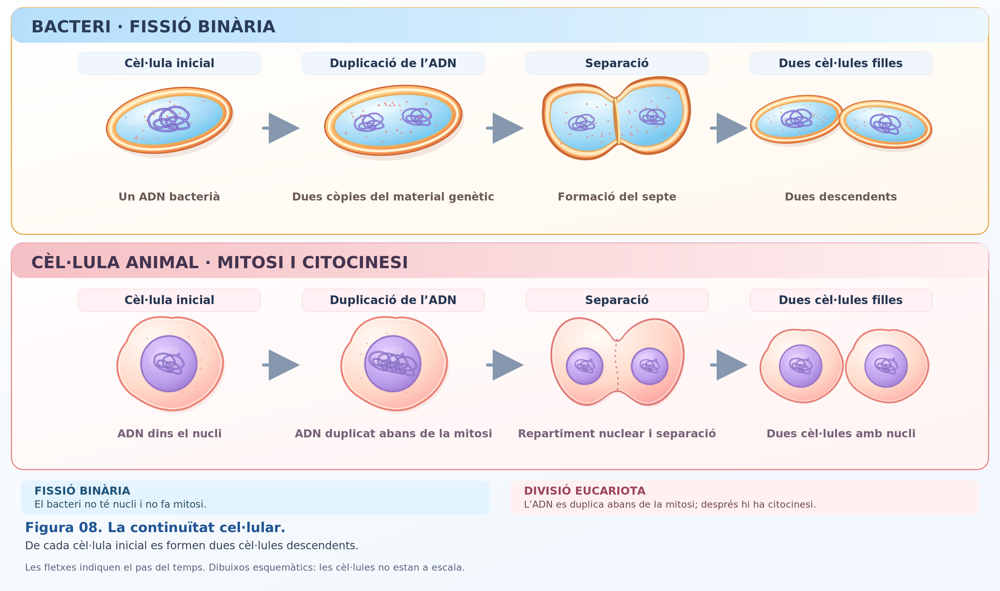
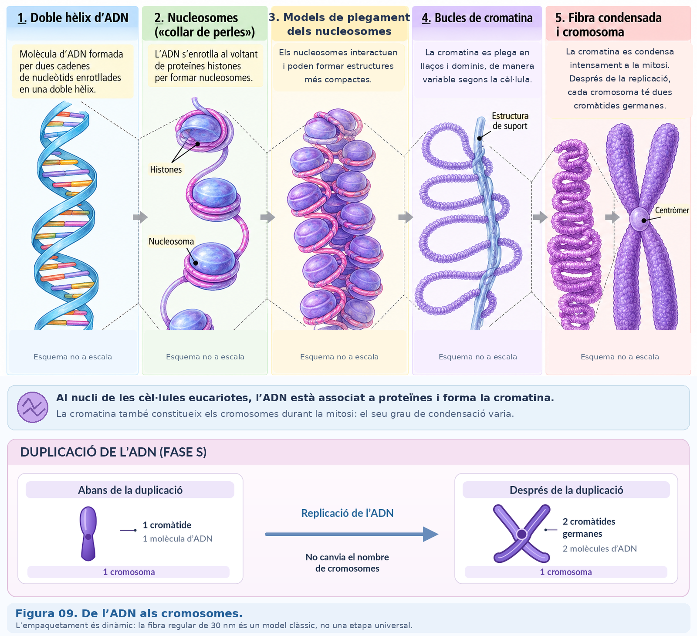
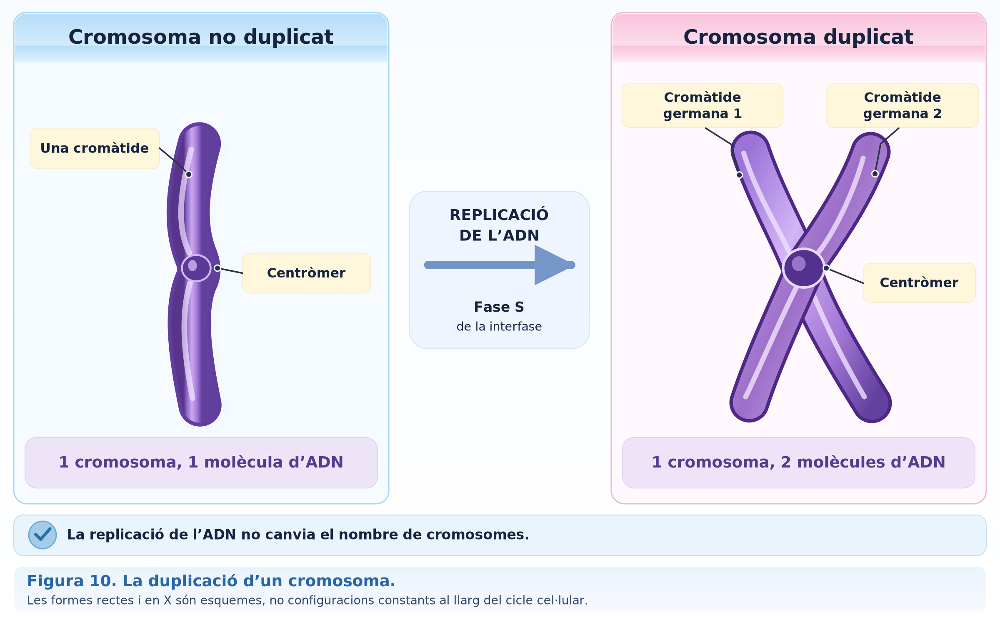
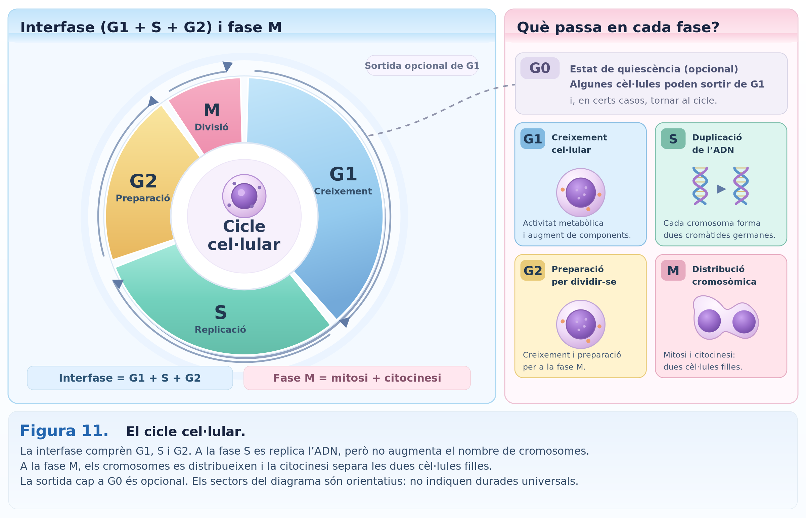
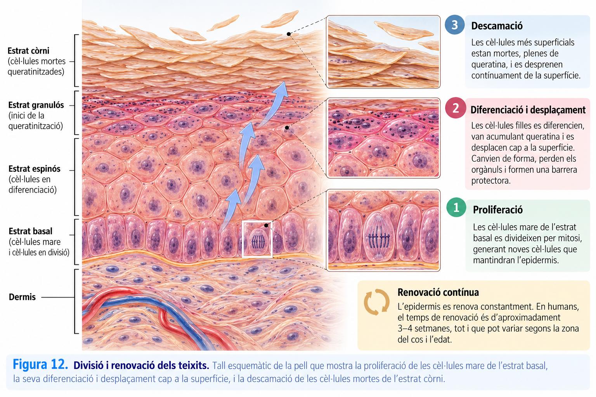

<section class="pv-seccio pv-portada" markdown>

# A02 · La continuïtat cel·lular

## Com pot una cèl·lula originar dues cèl·lules sense perdre la informació genètica?

**UD02 · La continuïtat cel·lular · Biologia i Geologia · 4t d'ESO**

Avui seguirem un problema fonamental: **abans de formar cèl·lules noves, la cèl·lula ha de copiar la informació genètica i després distribuir-la**. Observarem què són els cromosomes, què passa quan es duplica l'ADN i com s'organitza el cicle cel·lular.

**Aquesta pàgina recull el recorregut de la classe i serveix també per recuperar-la si no hi has pogut assistir.** Les comprovacions són per aprendre: **no cal entregar res**.

<!-- DOCENT: Pàgina preparada per al treball del bloc 2 del material guia. Itinerari orientatiu d'una sessió de 50 minuts. No considerar-la una crònica de classe fins a haver comprovat què s'ha treballat realment. Explicar funcionalment la replicació; el mecanisme molecular detallat correspon a la UD03. -->

</section>

<section class="pv-seccio pv-visual" markdown>

# 1 · Tota cèl·lula prové d'una altra cèl·lula

Una de les idees de la teoria cel·lular que ja hem conegut és que **tota cèl·lula prové d'una altra cèl·lula preexistent**.

Observa les dues seqüències de la figura:

- Molts **bacteris** formen cèl·lules descendents per *fissió binària*.
- En els organismes pluricel·lulars, la divisió de determinades **cèl·lules eucariotes** permet créixer i renovar teixits.

Els mecanismes no són idèntics: **els bacteris no fan mitosi**. Però comparteixen una necessitat: transmetre informació genètica a les cèl·lules descendents.

  
<strong>Si una cèl·lula es divideix, quin problema ha de resoldre per donar continuïtat a la vida?</strong>

  

    <button type="button" class="pv-opcio" data-feedback="a02-q1a" aria-pressed="false">A · Fer desaparèixer l'ADN de la cèl·lula inicial.</button>
    <button type="button" class="pv-opcio" data-feedback="a02-q1b" aria-pressed="false">B · Copiar i distribuir la informació genètica entre les descendents.</button>
    <button type="button" class="pv-opcio" data-feedback="a02-q1c" aria-pressed="false">C · Transformar totes les cèl·lules noves en bacteris.</button>
  

  
<strong>No.</strong> La informació genètica és necessària per al funcionament de les cèl·lules descendents. La continuïtat requereix transmetre-la, no eliminar-la.

  
<strong>Exacte.</strong> La còpia de la informació i el seu repartiment són processos diferents que han d'estar coordinats.

  
<strong>No.</strong> Els bacteris i les cèl·lules eucariotes segueixen mecanismes de divisió diferents. Dividir-se no canvia el tipus d'organització cel·lular.

<!-- DOCENT: Recollir breument a la pissarra «copiar → repartir». Fer comparar les dues seqüències sense assimilar fissió binària i mitosi. -->

</section>

<section class="pv-seccio pv-visual" markdown>

# 2 · On és la informació que s'ha de transmetre?

L'**ADN** conté la informació genètica. A les cèl·lules eucariotes, la major part és dins el nucli, associat a proteïnes: aquest conjunt s'anomena **cromatina**.

Un **cromosoma** és una estructura d'ADN associat a proteïnes. Durant el cicle cel·lular, la cromatina pot estar més o menys compactada; quan s'inicia la divisió nuclear, els cromosomes es condensen i solen ser més fàcils de distingir.

**Idea clau:** l'ADN no «es converteix» en una substància diferent quan apareixen cromosomes visibles. **Canvia sobretot el grau de compactació de l'ADN associat a proteïnes.**

Per situar-nos: una cèl·lula somàtica humana amb un nucli diploide normal té **46 cromosomes**, organitzats en 23 parelles. El nombre no és una mesura de la complexitat de l'espècie.

<!-- DOCENT: No aprofundir encara en homòlegs ni en la meiosi. La dada humana serveix per situar el recompte que treballarem a la diapositiva següent. -->

</section>

<section class="pv-seccio pv-visual" markdown>

# 3 · Primer copiar: la duplicació de l'ADN

Abans d'una divisió mitòtica típica, l'ADN es **replica**. Després de la duplicació, cada cromosoma té dues **cromàtides germanes**, unides a la regió del centròmer. Cada cromàtide conté una molècula d'ADN.

| En una cèl·lula somàtica humana típica | Abans de duplicar l'ADN | Després de duplicar l'ADN |
|---|---:|---:|
| Cromosomes | 46 | 46 |
| Cromàtides | 46 | 92 |
| Molècules d'ADN nuclear | 46 | 92 |

**Atenció:** **duplicar l'ADN no significa duplicar el nombre de cromosomes**. Cada cromosoma duplicat continua comptant com un cromosoma mentre les dues cromàtides germanes romanen unides.

  
<strong>Una cèl·lula té 4 cromosomes abans de la replicació. Just després de replicar l'ADN, quants cromosomes i quantes cromàtides té?</strong>

  

    <button type="button" class="pv-opcio" data-feedback="a02-q2a" aria-pressed="false">A · 8 cromosomes i 8 cromàtides.</button>
    <button type="button" class="pv-opcio" data-feedback="a02-q2b" aria-pressed="false">B · 4 cromosomes i 8 cromàtides.</button>
    <button type="button" class="pv-opcio" data-feedback="a02-q2c" aria-pressed="false">C · 4 cromosomes i 4 cromàtides.</button>
  

  
<strong>Has duplicat també el recompte de cromosomes.</strong> Després de la replicació hi ha dues cromàtides germanes per cromosoma, però continuen unides. Per això el nombre de cromosomes continua sent 4.

  
<strong>Correcte.</strong> Els 4 cromosomes continuen sent 4, però ara cadascun conté dues cromàtides germanes: en total, 8 cromàtides.

  
<strong>Revisa la figura.</strong> Si cada un dels 4 cromosomes es duplica, cadascun passa a tenir dues cromàtides; per tant, n'hi haurà 8.

<!-- DOCENT: Model simple 2n = 4. Evitar passar de cop a 4n = 8 com si replicar canviàs la ploidia. La separació de cromàtides es desenvoluparà a A03 (mitosi). -->

</section>

<section class="pv-seccio pv-visual" markdown>

# 4 · Quan copia l'ADN? El cicle cel·lular

Les cèl·lules no es divideixen contínuament. En el **cicle mitòtic** d'una cèl·lula eucariota que es divideix, distingim la **interfase** i la **fase M**.

- **G1 (interfase):** la cèl·lula creix i desenvolupa les seves funcions.
- **S (interfase):** es **duplica l'ADN**.
- **G2 (interfase):** continua la preparació per a la divisió.
- **M:** es produeix la **mitosi**, que distribueix els cromosomes entre els nuclis descendents, i habitualment la **citocinesi**, que separa el citoplasma.

Algunes cèl·lules passen a un estat **G0**, en què continuen funcionant sense dividir-se. La durada de les fases depèn del tipus de cèl·lula i de les condicions.

  
<strong>Quina afirmació situa correctament dos processos del cicle cel·lular?</strong>

  

    <button type="button" class="pv-opcio" data-feedback="a02-q3a" aria-pressed="false">A · A la fase S es reparteixen els cromosomes; durant la mitosi es duplica l'ADN.</button>
    <button type="button" class="pv-opcio" data-feedback="a02-q3b" aria-pressed="false">B · A la fase S es duplica l'ADN; durant la mitosi es distribueixen els cromosomes.</button>
    <button type="button" class="pv-opcio" data-feedback="a02-q3c" aria-pressed="false">C · La interfase és un període en què la cèl·lula no fa res.</button>
  

  
<strong>Has intercanviat els processos.</strong> Primer es copia l'ADN durant la fase S; després, durant la mitosi, es distribueix el material genètic entre els nuclis descendents.

  
<strong>Exacte.</strong> La diferència entre <em>duplicar</em> i <em>repartir</em> és la idea central d'aquesta activitat.

  
<strong>No.</strong> Durant la interfase la cèl·lula pot créixer, treballar, replicar l'ADN i preparar la divisió. No és un temps d'inactivitat.

<!-- DOCENT: El diagrama F11 no representa durades universals. Per ara, no cal ensenyar totes les fases microscòpiques de la mitosi; corresponen al bloc 3. -->

</section>

<section class="pv-seccio pv-visual" markdown>

# 5 · Per què la divisió ha d'estar controlada?

En un organisme pluricel·lular, les divisions han de respondre a les **necessitats dels teixits**. Algunes cèl·lules es divideixen per contribuir a la renovació; d'altres, com moltes neurones madures, habitualment no ho fan.

**No totes les cèl·lules del teixit es divideixen alhora.** El cicle està regulat per mecanismes que controlen si les condicions són adequades i contribueixen a evitar errors en la duplicació o distribució de l'ADN.

Una proliferació cel·lular descontrolada és una característica del **càncer**, encara que per originar un tumor hi intervenen altres alteracions.

<strong>Per pensar-ho:</strong> per què seria problemàtic que totes les cèl·lules d'un teixit es dividissin permanentment, independentment de les necessitats de l'organisme?

<!-- DOCENT: Discussió oral opcional. No exigir resposta escrita. Mantenir el càncer com a exemple de pèrdua de control, no com a estudi detallat de les seves causes. -->

</section>

<section class="pv-seccio" markdown>

# 6 · Què hauries de saber explicar ara?

- **Per què** les cèl·lules noves han de rebre informació genètica.
- **Com es relacionen** ADN, cromatina, cromosomes i cromàtides.
- **Per què** després de replicar l'ADN hi ha el mateix nombre de cromosomes, però el doble de cromàtides.
- **Quan** es duplica l'ADN i **quan** es distribueixen els cromosomes al llarg del cicle cel·lular.
- **Per què** el control de la divisió és important per als teixits.

**Si no has vengut a classe:** segueix aquestes seccions en ordre, observa les figures F08–F12 i respon les tres comprovacions interactives. Després consulta el [bloc 2 del material guia de la UD02](../../../material/ud2/ud2.md), on trobaràs les explicacions completes.

**No cal lliurar res d'aquesta activitat.** La pàgina és una guia de l'explicació i un recurs de consulta i repàs.

**Pròximament:** estudiarem **com es reparteixen físicament els cromosomes durant la mitosi**, que és el centre del bloc 3.

<!-- DOCENT: Després de la classe, revisar si el recorregut coincideix amb allò realment treballat. Si no s'han tractat F12 o G0, marcar-los com a ampliació/consulta; no afirmar que s'han explicat. -->

</section>

