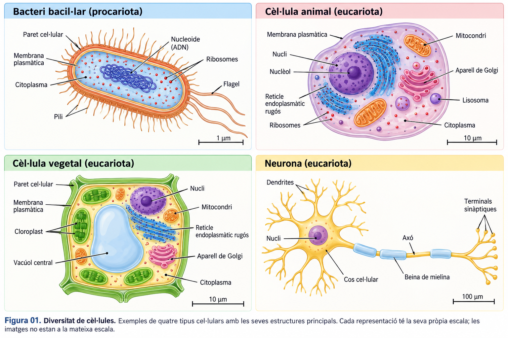
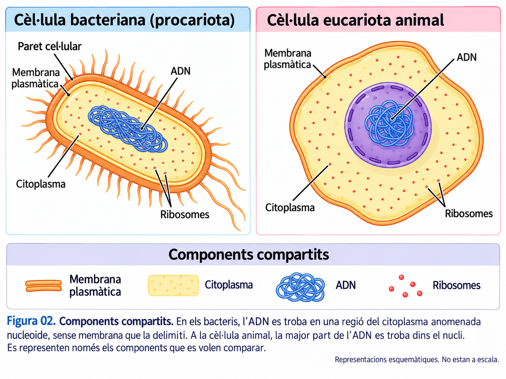
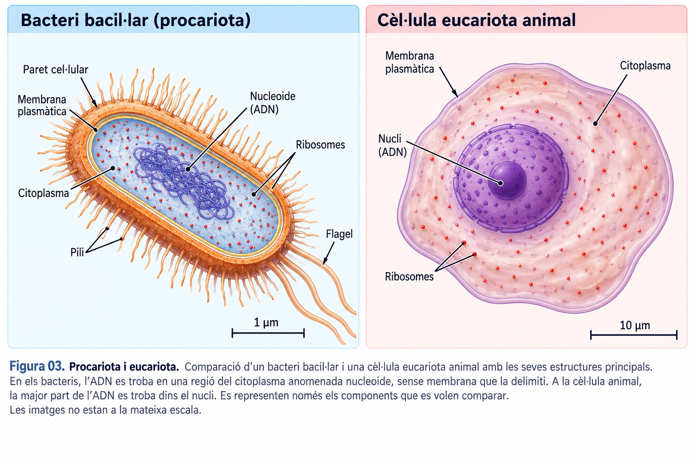
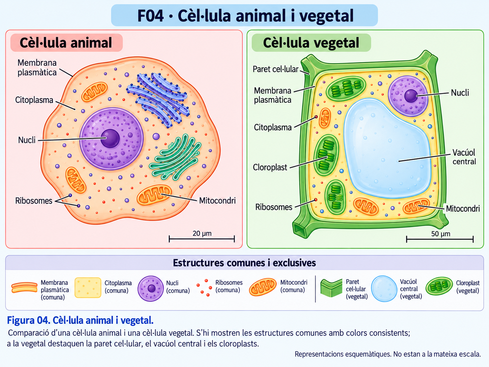
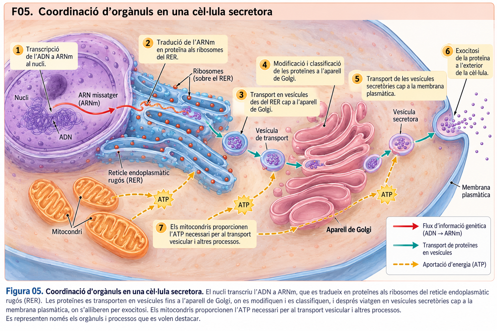
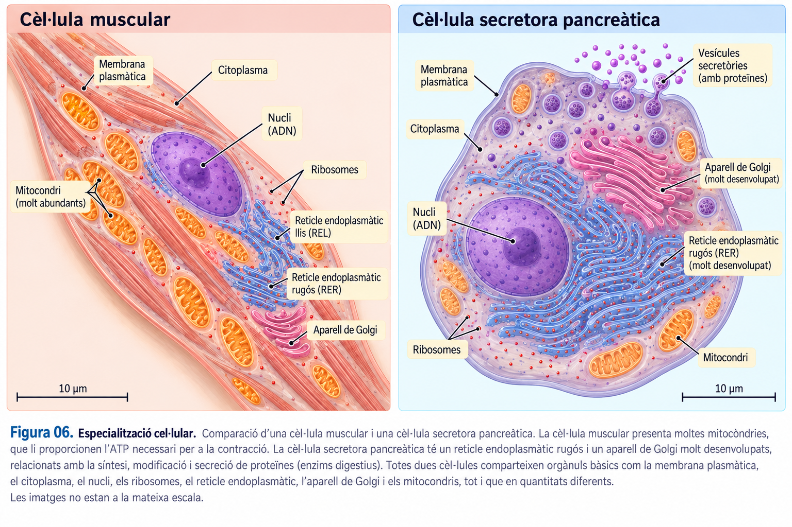
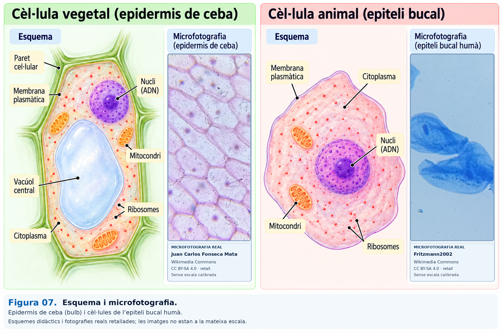

<section class="pv-seccio pv-portada" markdown>

# A01 · La diversitat cel·lular

## Com poden ser tan diferents les cèl·lules si totes comparteixen una organització bàsica?

**UD02 · La continuïtat cel·lular · Biologia i Geologia · 4t d'ESO**

En aquest recorregut compararem cèl·lules, relacionarem estructures i funcions i seguirem la cooperació entre orgànuls. **Les comprovacions són per aprendre i repassar; no s'han de lliurar.**

<!-- DOCENT: Presentació i repàs autònom. Proposta d'ús distribuïda en dues sessions, sense exigir que s'empleni al quadern. El material guia complet és la referència d'estudi. -->

</section>

<section class="pv-seccio pv-visual" markdown>

# 1 · Diversitat de formes, una mateixa base

Un bacteri, una neurona i una cèl·lula vegetal poden tenir formes molt diferents. La seva **forma i organització estan relacionades amb les funcions** que desenvolupen.

La **teoria cel·lular** estableix que tots els éssers vius estan formats per una o més cèl·lules; que la cèl·lula és la unitat bàsica d'estructura i funcionament; i que tota cèl·lula prové d'una altra cèl·lula preexistent.

**Idea clau:** la diversitat de formes no impedeix que totes les cèl·lules comparteixin alguns components fonamentals.

</section>

<section class="pv-seccio pv-visual" markdown>

# 2 · Què comparteixen totes les cèl·lules?

- **Membrana plasmàtica:** delimita la cèl·lula i regula els intercanvis amb el medi.
- **Citoplasma:** inclou el citosol i les estructures que conté; és on es duen a terme moltes reaccions.
- **ADN:** conté informació necessària per al funcionament i la continuïtat cel·lular.
- **Ribosomes:** participen en la síntesi de proteïnes.

<strong>«Els bacteris no tenen nucli; per tant, no tenen ADN». Què en penses?</strong>

  

    <button type="button" class="pv-opcio" data-feedback="a01-q1a" aria-pressed="false">És correcte: l'ADN només es troba dins el nucli.</button>
    <button type="button" class="pv-opcio" data-feedback="a01-q1b" aria-pressed="false">És incorrecte: els bacteris tenen ADN, però no dins un nucli delimitat per membrana.</button>
  

  
<strong>Revisa-ho.</strong> La presència d'ADN no implica que hi hagi un nucli. Les cèl·lules bacterianes tenen ADN, situat principalment en una regió del citoplasma anomenada <em>nucleoide</em>.

  
<strong>Exacte.</strong> Totes les cèl·lules comparteixen material genètic, però no totes l'organitzen dins un nucli. La distinció és essencial per identificar procariotes i eucariotes.

</section>

<section class="pv-seccio pv-visual" markdown>

# 3 · Dos models d'organització cel·lular

Les **procariotes** no tenen nucli delimitat per membrana: l'ADN se situa principalment en el nucleoide. No presenten els orgànuls membranosos típics de les eucariotes. Els bacteris i els arqueus són procariotes.

Les **eucariotes** tenen la major part de l'ADN dins un nucli i disposen d'orgànuls membranosos, com els mitocondris, el reticle endoplasmàtic o l'aparell de Golgi.

<strong>En una cèl·lula s'ha comprovat que l'ADN no és dins un nucli membranós, però s'hi observen ribosomes. Quin model hi encaixa?</strong>

  

    <button type="button" class="pv-opcio" data-feedback="a01-q2a" aria-pressed="false">Organització procariota.</button>
    <button type="button" class="pv-opcio" data-feedback="a01-q2b" aria-pressed="false">Organització eucariota animal.</button>
    <button type="button" class="pv-opcio" data-feedback="a01-q2c" aria-pressed="false">No pot ser una cèl·lula perquè té ribosomes.</button>
  

  
<strong>Exacte.</strong> El criteri decisiu és l'absència comprovada d'un nucli envoltat per membrana. Els ribosomes també són propis de les procariotes.

  
<strong>No encaixa.</strong> Les cèl·lules animals són eucariotes i tenen un nucli delimitat per membrana. Els ribosomes no permeten distingir aquests dos grups perquè tots dos en tenen.

  
<strong>Justament al contrari.</strong> Els ribosomes són estructures presents a les cèl·lules. Són necessaris per sintetitzar proteïnes.

**Recorda:** procariota no vol dir «cèl·lula incompleta». És una organització cel·lular funcional, amb gran diversitat.

</section>

<section class="pv-seccio pv-visual" markdown>

# 4 · Animals i vegetals: dues formes de ser eucariota

Les cèl·lules animals i vegetals comparteixen **nucli, membrana, ribosomes, mitocondris, reticle endoplasmàtic i aparell de Golgi**. Moltes cèl·lules vegetals tenen, a més, paret cel·lular de cel·lulosa i un gran vacúol central. Les cèl·lules vegetals fotosintètiques presenten cloroplasts.

<strong>Una cèl·lula d'una arrel té nucli, paret cel·lular i un gran vacúol, però no cloroplasts. Quina conclusió és coherent?</strong>

  

    <button type="button" class="pv-opcio" data-feedback="a01-q3a" aria-pressed="false">És animal perquè no té cloroplasts.</button>
    <button type="button" class="pv-opcio" data-feedback="a01-q3b" aria-pressed="false">Pot ser vegetal: no totes les cèl·lules de les plantes tenen cloroplasts.</button>
    <button type="button" class="pv-opcio" data-feedback="a01-q3c" aria-pressed="false">És procariota perquè té paret cel·lular.</button>
  

  
<strong>No.</strong> L'absència de cloroplasts no és prova d'organització animal. Les cèl·lules vegetals no fotosintètiques, com moltes de les arrels, no en tenen.

  
<strong>Exacte.</strong> La paret, el gran vacúol i el context d'una arrel són compatibles amb una cèl·lula vegetal. La fotosíntesi no es duu a terme en totes les cèl·lules de la planta.

  
<strong>No.</strong> Alguns procariotes tenen paret, però la paret no els és exclusiva. El nucli membranós indica organització eucariota.

**Una altra generalització que cal evitar:** les cèl·lules vegetals **també tenen mitocondris** i duen a terme respiració cel·lular.

</section>

<section class="pv-seccio" markdown>

# 5 · Què fa cada orgànul?

Identificar els orgànuls i conèixer-ne la funció és el primer pas per explicar com funciona una cèl·lula. Intentau recordar què fa cada estructura **abans de descobrir-ne la resposta**.

  <button type="button" class="pv-terme" data-resposta="Sintetitzen proteïnes">Ribosomes</button>
  <button type="button" class="pv-terme" data-resposta="Processa moltes proteïnes destinades a secreció o a membranes">Reticle endoplasmàtic rugós</button>
  <button type="button" class="pv-terme" data-resposta="Modifica, classifica i distribueix proteïnes i lípids">Aparell de Golgi</button>
  <button type="button" class="pv-terme" data-resposta="Participen en la respiració cel·lular i la producció d'ATP">Mitocondris</button>

<strong>Consulta la resta d'estructures i funcions del material guia</strong>

| Estructura | Funció principal |
|---|---|
| Membrana plasmàtica | Regula intercanvis i comunicació amb l'exterior. |
| Nucli | Conté la major part de l'ADN eucariota i participa en la regulació cel·lular. |
| Reticle endoplasmàtic llis | Síntesi de lípids i regulació del calci, entre altres funcions. |
| Lisosomes | Digestió i reciclatge de materials, especialment en cèl·lules animals. |
| Vacúols | Emmagatzematge; en plantes també participen en la turgència. |
| Cloroplasts | Fotosíntesi en les cèl·lules fotosintètiques. |
| Citoesquelet | Suport de la forma, organització i moviment cel·lular. |
| Centrosoma | Organització dels microtúbuls en moltes cèl·lules animals. |

**Idea clau:** els orgànuls no funcionen com a peces independents. Les funcions cel·lulars depenen de la seva **coordinació**.

**Practica abans de continuar:** relaciona noms i funcions en tots dos sentits. Les targetes van desapareixent amb els encerts; si t'equivoques, tota la ronda es reinicia amb les 12 cartes barrejades.

[Practica amb les 12 targetes](../organuls/index.html){ .md-button .md-button--primary }

</section>

<section class="pv-seccio pv-visual" markdown>

# 6 · Com fabrica i secreta una proteïna una cèl·lula?

Algunes cèl·lules del pàncrees produeixen proteïnes que s'han d'alliberar a l'exterior. El procés requereix diferents estructures:

ADN del nucli → ARN missatger → ribosomes del reticle rugós → vesícules → aparell de Golgi → vesícules secretores → membrana i exocitosi

L'ADN aporta la informació; els ribosomes sintetitzen les proteïnes; el reticle i el Golgi participen en el processament i el transport; i les vesícules secretores permeten alliberar-les. Els **mitocondris proporcionen ATP** per a moltes d'aquestes activitats, però **no són una estació del trajecte físic de la proteïna**.

</section>

<section class="pv-seccio" markdown>

# 7 · Què passa si falla una peça del sistema?

<strong>En una cèl·lula secretora l'aparell de Golgi deixa de funcionar correctament. Quina conseqüència és més probable?</strong>

  

    <button type="button" class="pv-opcio" data-feedback="a01-q4a" aria-pressed="false">Desapareix automàticament l'ADN del nucli.</button>
    <button type="button" class="pv-opcio" data-feedback="a01-q4b" aria-pressed="false">Poden alterar-se la modificació, la classificació i l'enviament de proteïnes destinades a la secreció.</button>
    <button type="button" class="pv-opcio" data-feedback="a01-q4c" aria-pressed="false">Els ribosomes es converteixen en mitocondris.</button>
  

  
<strong>No.</strong> El Golgi no és on s'emmagatzema l'ADN nuclear. Revisa la funció del nucli i el paper del Golgi en el trànsit cel·lular.

  
<strong>Exacte.</strong> Els ribosomes poden continuar sintetitzant proteïnes, però el seu processament i encaminament adequats es poden veure alterats. Una funció complexa depèn de la coordinació de diverses estructures.

  
<strong>No.</strong> Cada orgànul té una estructura i unes funcions pròpies; no es transforma en un altre per compensar una fallada.

**El que importa és el raonament causal:** identificar quina funció feia l'estructura, quin procés hi depenia i què es veuria afectat.

</section>

<section class="pv-seccio pv-visual" markdown>

# 8 · Especialització: mateixa base, diferents necessitats

Una cèl·lula muscular amb molta activitat contràctil necessita energia i pot tenir nombrosos mitocondris. Una cèl·lula que secreta moltes proteïnes pot tenir el reticle endoplasmàtic rugós i l'aparell de Golgi molt desenvolupats.

<strong>Què podem concloure si una cèl·lula té un reticle rugós i un Golgi especialment desenvolupats?</strong>

  

    <button type="button" class="pv-opcio" data-feedback="a01-q5a" aria-pressed="false">És compatible amb una activitat intensa de síntesi i processament de proteïnes per a secreció.</button>
    <button type="button" class="pv-opcio" data-feedback="a01-q5b" aria-pressed="false">No té mitocondris, perquè una cèl·lula només pot tenir un tipus d'orgànul.</button>
    <button type="button" class="pv-opcio" data-feedback="a01-q5c" aria-pressed="false">Totes les cèl·lules han de tenir exactament el mateix nombre d'orgànuls.</button>
  

  
<strong>Ben raonat.</strong> L'abundància relativa d'alguns orgànuls aporta indicis sobre l'especialització funcional, però no és una prova absoluta de la funció concreta de la cèl·lula.

  
<strong>Compte.</strong> Un orgànul abundant no implica que els altres siguin absents. També aquestes cèl·lules necessiten ATP i tenen mitocondris.

  
<strong>No.</strong> Les cèl·lules especialitzades poden diferir en la quantitat i el desenvolupament dels orgànuls, d'acord amb la seva funció.

</section>

<section class="pv-seccio pv-visual" markdown>

# 9 · Un esquema no és una microfotografia

Els **esquemes** destaquen estructures per facilitar-ne la comprensió. Les **microfotografies** depenen de l'instrument, la preparació, la tinció, la resolució i el pla observat.

**Fonts de les microfotografies de F07:** epidermis de ceba — [Juan Carlos Fonseca Mata, Wikimedia Commons](https://commons.wikimedia.org/wiki/File:Onion_epidermis_(microscopic_image)_007533276M.jpg); cèl·lules de la mucosa bucal humana — [Fritzmann2002, Wikimedia Commons](https://commons.wikimedia.org/wiki/File:Human_Cheek_Cells_(Methylene_Blue_Stain).jpg). Ambdues imatges: [CC BY-SA 4.0](https://creativecommons.org/licenses/by-sa/4.0/deed.ca). S'han incorporat a una composició didàctica amb esquemes.

<strong>En una microfotografia no s'identifica clarament el nucli. Quina conclusió és científicament prudent?</strong>

  

    <button type="button" class="pv-opcio" data-feedback="a01-q6a" aria-pressed="false">És segur que la cèl·lula no té nucli.</button>
    <button type="button" class="pv-opcio" data-feedback="a01-q6b" aria-pressed="false">No podem afirmar-ne l'absència només perquè no es distingeix a la imatge.</button>
    <button type="button" class="pv-opcio" data-feedback="a01-q6c" aria-pressed="false">És segur que la cèl·lula és vegetal.</button>
  

  
<strong>La conclusió va massa enllà de l'observació.</strong> El nucli pot quedar fora del pla, no estar tenyit o no distingir-se amb la tècnica usada.

  
<strong>Exacte.</strong> «No visible» no significa necessàriament «absent». Cal considerar el tipus de preparació, la resolució i altres evidències.

  
<strong>No.</strong> Per identificar una cèl·lula vegetal cal cercar indicis pertinents, com la paret cel·lular o, en cèl·lules fotosintètiques, els cloroplasts. La manca de visibilitat d'un nucli no basta.

**Recorda:** sense una escala adequada tampoc no podem deduir amb seguretat la mida real a partir de l'aspecte de la imatge.

</section>

<section class="pv-seccio" markdown>

# 10 · Què hauries de saber explicar ara?

- **Què comparteixen** totes les cèl·lules i en què poden diferir.
- **Com justificar** si una cèl·lula segueix un model procariota o eucariota, animal o vegetal.
- **Quines funcions** desenvolupen les estructures principals.
- **Com cooperen** els orgànuls perquè una proteïna pugui ser secretada.
- **Què podem afirmar** —i què no— quan interpretam un esquema o una microfotografia.

Per preparar-te o recuperar una classe perduda, consulta el [Bloc 1 del material guia de la UD02](../../../material/ud2/ud2.md). Hi trobaràs les explicacions completes, la taula d'orgànuls i les figures de referència.

**No cal lliurar les respostes interactives.** Pots tornar a les seccions anteriors per revisar qualsevol dubte.

<!-- DOCENT: Sense evidència formal específica. Si cal una evidència formativa individual, proposar un cas breu amb identificació justificada de model cel·lular i explicació funcional de dos orgànuls; evitar una fitxa de còpia del material. -->

</section>

<section class="pv-seccio" markdown>

# 11 · Investiga i comparteix

## Els secrets de les cèl·lules

Ja coneixes les estructures cel·lulars principals i les seves funcions. Ara investigaràs **un fenomen real** que no hem resolt a les comprovacions interactives.

Cada alumne rebrà **una miniinvestigació diferent**. Llegeix-ne l'article científic adaptat, respon les preguntes de la fitxa i prepara una explicació breu per compartir la descoberta amb els companys.

**Què has de fer?**

1. Obre l'**article** del repte que t'ha assignat el professor.
2. Llegeix-lo i respon les preguntes de la **fitxa de miniinvestigació** amb les teves paraules.
3. Prepara una presentació de **Canva d'una o dues diapositives**, amb un esquema propi del mecanisme.
4. Explica la descoberta als companys en **2–3 minuts**, sense limitar-te a llegir les respostes.

### Miniinvestigacions

!!! question "1 · Per què relaxar un múscul també consumeix energia?"
    Descobreix com el **reticle sarcoplasmàtic**, el **calci** i l'**ATP** cooperen perquè una fibra muscular es pugui relaxar.

    - [**Llegeix l'article científic**](../../../divulgacio/ud02/01-rel-calci.md)
    - [**Obre la fitxa de miniinvestigació**](fitxes/01-rel-calci.md)

!!! question "2 · La fina línia que sosté la vida"
    Investiga com els **fosfolípids**, el **reticle endoplasmàtic** i les **vesícules** permeten fabricar i ampliar les membranes cel·lulars.

    - [**Llegeix l'article científic**](../../../divulgacio/ud02/02-fina-linia-vida.md)
    - [**Obre la fitxa de miniinvestigació**](fitxes/02-fina-linia-vida.md)

!!! question "3 · Monòxid de carboni: asfíxia cel·lular"
    Descobreix per què el **monòxid de carboni** pot dificultar el transport d'**oxigen** i reduir la producció d'**ATP** als mitocondris.

    - [**Llegeix l'article científic**](../../../divulgacio/ud02/03-gas-invisible.md)
    - [**Obre la fitxa de miniinvestigació**](fitxes/03-gas-invisible.md)

!!! question "4 · La trampa invisible dins les neurones"
    Descobreix com una alteració del gen **HEXA** pot afectar un **enzim lisosomal** i provocar l'acumulació de **GM2** a les neurones.

    - [**Llegeix l'article científic**](../../../divulgacio/ud02/04-trampa-neurones.md)
    - [**Obre la fitxa de miniinvestigació**](fitxes/04-trampa-neurones.md)

*Els altres tres reptes s'incorporaran aquí quan estiguin preparats.*

**Què s'ha de lliurar?** La fitxa amb les respostes i la presentació de Canva, segons les indicacions del professor. Les respostes de les comprovacions interactives de les seccions anteriors **no** s'han de lliurar.

</section>

