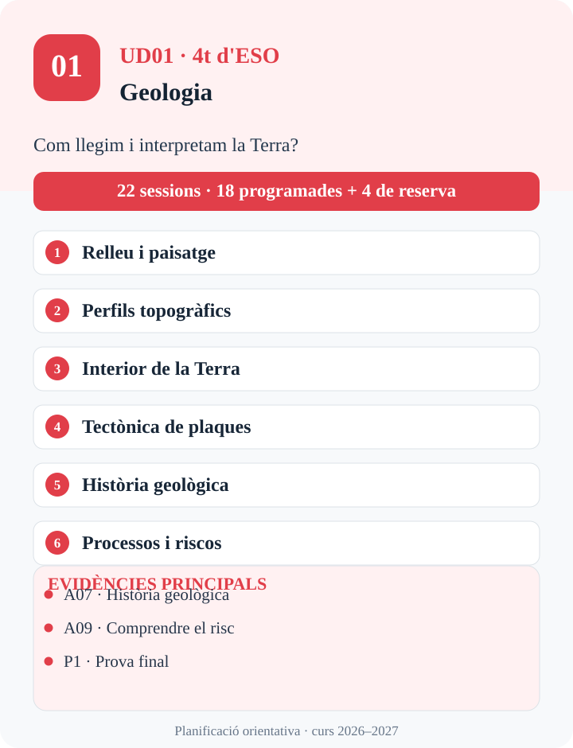
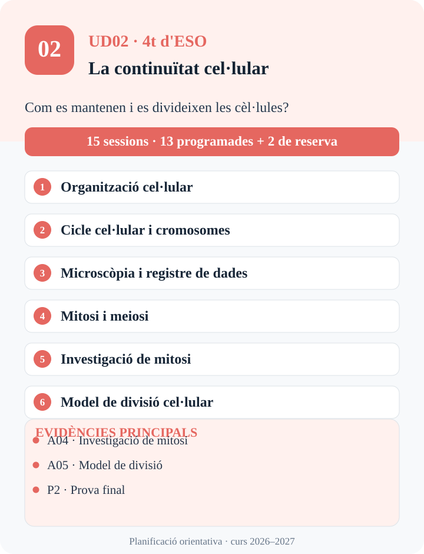
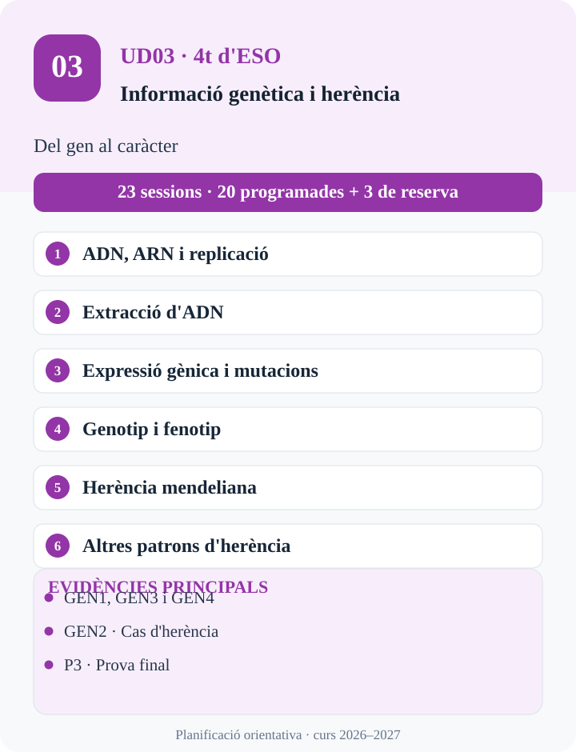
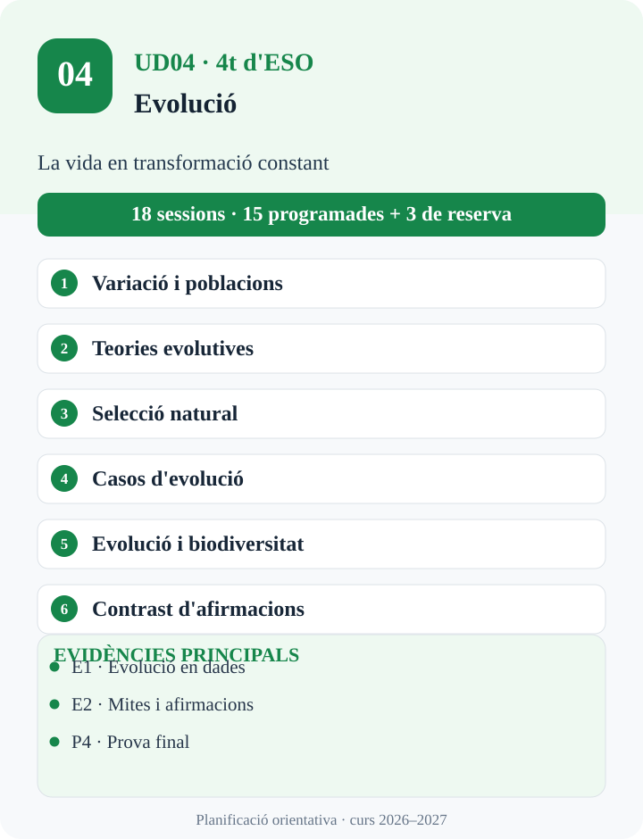
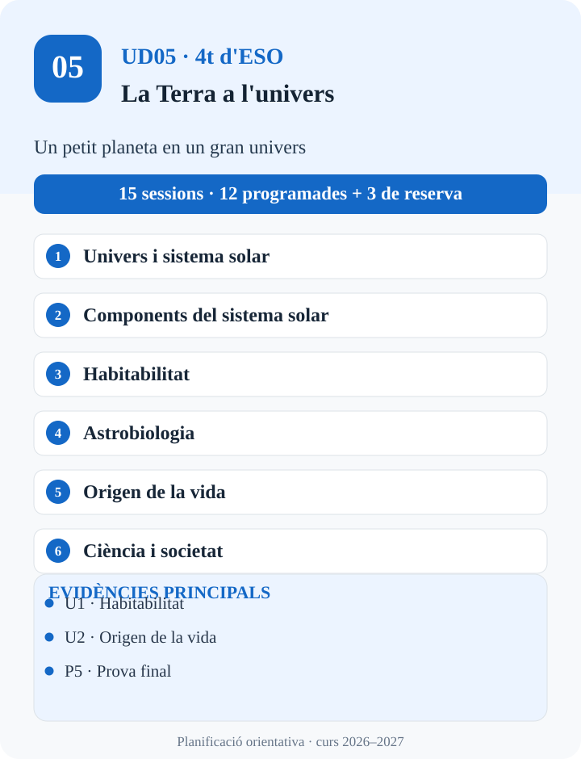

# Calendari del curs

**Biologia i Geologia · 4t d'ESO · 2026–2027**

Aquest és el recorregut visual per les **cinc unitats didàctiques**, organitzades en tres trams orientatius del curs. Cada unitat inclou un resum visual ampliable, les sessions previstes i un accés als materials o a la programació.

!!! info "Planificació flexible"
    La [programació didàctica](programacio.md) preveu **78 sessions programades i 15 sessions de reserva flexible: 93 sessions en total**, de 50 minuts, distribuïdes habitualment entre dimarts, dijous i divendres. Les divisions per trimestres orienten el recorregut, però **no fixen dates exactes**. Les dates i alguns elements de les infografies de treball encara s'han de revisar abans de presentar-los com a definitius.

<section class="cal-trimestre cal-trimestre--1" markdown="1">

## Primer trimestre · De setembre a desembre

Estudiam el planeta i les cèl·lules: com interpretam la Terra i com es manté la vida.

**37 sessions totals previstes** · 2 unitats

<article class="cal-ud" markdown="1">
<a class="cal-miniatura" href="infografies-calendari/ud01.svg" target="_blank" rel="noopener noreferrer" title="Amplia el resum visual de UD01" aria-label="Amplia el resum visual de UD01 en una pestanya nova">
  
  Amplia el resum visual ↗
</a>

### UD01 · Geologia

Interpretam paisatges, models de la Terra i processos geològics per reconstruir el passat i valorar els riscs.

22 sessions · 18 programades + 4 de reserva

[Consulta el material de la UD01](material/ud1/ud1.md)
</article>

<article class="cal-ud" markdown="1">
<a class="cal-miniatura" href="infografies-calendari/ud02.svg" target="_blank" rel="noopener noreferrer" title="Amplia el resum visual de UD02" aria-label="Amplia el resum visual de UD02 en una pestanya nova">
  
  Amplia el resum visual ↗
</a>

### UD02 · La continuïtat cel·lular

Estudiam les cèl·lules, la duplicació de l'ADN, la divisió cel·lular i la microscòpia.

15 sessions · 13 programades + 2 de reserva

[Consulta el material de la UD02](material/ud2/ud2.md)
</article>

</section>

<section class="cal-trimestre cal-trimestre--2" markdown="1">

## Segon trimestre · De gener a març

Exploram com s'organitza, s'expressa i es transmet la informació genètica.

**23 sessions totals previstes** · 1 unitat

<article class="cal-ud" markdown="1">
<a class="cal-miniatura" href="infografies-calendari/ud03.svg" target="_blank" rel="noopener noreferrer" title="Amplia el resum visual de UD03" aria-label="Amplia el resum visual de UD03 en una pestanya nova">
  
  Amplia el resum visual ↗
</a>

### UD03 · Informació genètica i herència

Analitzam com s'emmagatzema, s'expressa i es transmet la informació genètica.

23 sessions · 20 programades + 3 de reserva

[Consulta la programació de la UD03](programacio.md)
</article>

</section>

<section class="cal-trimestre cal-trimestre--3" markdown="1">

## Tram final de curs · De març a maig

Investigam l'evolució de la vida i situam la Terra dins l'univers.

**33 sessions totals previstes** · 2 unitats

<article class="cal-ud" markdown="1">
<a class="cal-miniatura" href="infografies-calendari/ud04.svg" target="_blank" rel="noopener noreferrer" title="Amplia el resum visual de UD04" aria-label="Amplia el resum visual de UD04 en una pestanya nova">
  
  Amplia el resum visual ↗
</a>

### UD04 · Evolució

Interpretam dades evolutives i contrastam explicacions sobre el canvi de les poblacions.

18 sessions · 15 programades + 3 de reserva

[Consulta la programació de la UD04](programacio.md)
</article>

<article class="cal-ud" markdown="1">
<a class="cal-miniatura" href="infografies-calendari/ud05.svg" target="_blank" rel="noopener noreferrer" title="Amplia el resum visual de UD05" aria-label="Amplia el resum visual de UD05 en una pestanya nova">
  
  Amplia el resum visual ↗
</a>

### UD05 · La Terra a l'univers

Exploram l'univers, el sistema solar, la recerca astrobiològica i les hipòtesis sobre l'origen de la vida.

15 sessions · 12 programades + 3 de reserva

[Consulta la programació de la UD05](programacio.md)
</article>

</section>

---

### Com llegir el calendari?

Les unitats segueixen l'ordre **UD01 → UD05**. Els nombres de sessions inclouen les reserves flexibles. Els resums visuals que es mostren en aquesta pàgina són una **síntesi adaptada a la programació vigent**, no una reproducció literal de les infografies de treball.

Les dates d'inici i finalització de les unitats dependran del calendari lectiu real i del progrés dels grups. Les activitats i evidències concretes es descriuen a la [programació didàctica](programacio.md).
