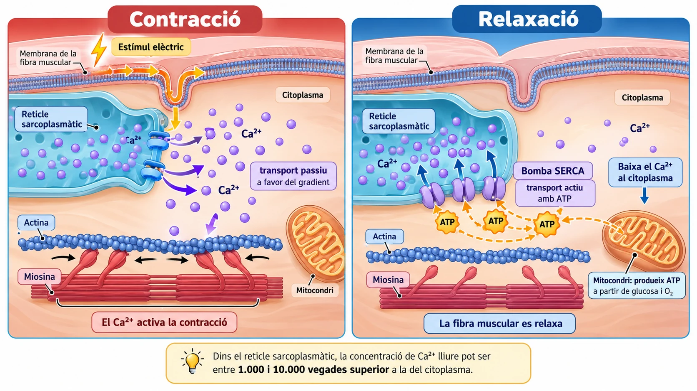

# Per què relaxar un múscul també consumeix energia?

*Quan deixam de fer força amb un múscul, dins les seves cèl·lules continua havent-hi molta activitat. Unes petites bombes moleculars treballen per retirar un senyal químic: el calci.*

Imagina que sostens una bossa carregada. Notes com els músculs del braç fan força per aguantar-ne el pes. Quan deixes la bossa damunt una taula, aquests músculs poden relaxar-se.

Podria semblar que relaxar-se és tan senzill com deixar de treballar. Però, dins les fibres musculars, passa una cosa sorprenent: **la relaxació també necessita energia**.

Per entendre per què, hem d'investigar què passa amb una substància que coneixem sobretot perquè forma part dels ossos: el calci.

## Tot comença amb un senyal elèctric

Les fibres musculars són cèl·lules especialitzades en la contracció.

Quan una neurona motora envia un impuls nerviós a una fibra muscular, aquesta rep un senyal que desencadena un **impuls elèctric a la seva membrana plasmàtica**.

El senyal es propaga per la membrana i penetra cap a l'interior de la fibra muscular a través d'unes petites prolongacions anomenades *túbuls T*.

Això provoca l'obertura d'uns canals de calci situats a la membrana del **reticle sarcoplasmàtic**, una forma especialitzada del reticle endoplasmàtic llis (REL).

Però, quin paper hi té el calci?

## El calci: un senyal per activar la contracció

El reticle sarcoplasmàtic funciona com un magatzem d'ions de calci (Ca²⁺).

Quan s'obren els canals de la seva membrana, el calci surt del reticle i passa al citoplasma de la fibra muscular.

L'augment de la concentració de Ca²⁺ al citoplasma activa un mecanisme que permet la interacció de dues proteïnes, l'**actina i la miosina**. Aquestes proteïnes generen la força necessària perquè la fibra muscular es contregui, utilitzant ATP.

Per tant, el calci no és el combustible de la contracció: **és un senyal que permet activar-la**.

!!! info "Una diferència de concentració extraordinària"
    En una fibra muscular en repòs, la concentració de calci lliure a l'interior del reticle sarcoplasmàtic pot ser aproximadament **entre 1.000 i 10.000 vegades superior** a la del citoplasma.

    Aquesta enorme diferència de concentració permet que, quan s'obren els canals adequats, el Ca²⁺ surti ràpidament cap al citoplasma.

    El calci es mou a favor del seu gradient electroquímic, mitjançant un procés de **transport passiu**. Això significa que la seva sortida no requereix consumir ATP directament.

    La cèl·lula ja ha invertit energia prèviament per mantenir aquesta diferència de concentració.

    *La proporció és aproximada i es refereix al Ca²⁺ lliure, no a tot el calci emmagatzemat.*

*Figura 1. Durant la contracció, el Ca²⁺ surt del reticle sarcoplasmàtic per transport passiu. Durant la relaxació, les bombes SERCA el retornen al reticle consumint ATP. Esquema didàctic, no representat a escala.*

## Per relaxar-se, cal tornar a guardar el calci

Quan acaba el senyal que ha desencadenat la contracció, els canals del reticle deixen d'alliberar calci de manera intensa.

Però el Ca²⁺ que ha passat al citoplasma encara hi és. Perquè la fibra muscular es pugui relaxar, la seva concentració ha de disminuir.

Aquí entren en acció unes proteïnes molt especials: les **bombes de calci SERCA**, situades a la membrana del reticle sarcoplasmàtic.

Aquestes bombes transporten el Ca²⁺ del citoplasma cap a l'interior del reticle, on la concentració de calci ja és molt elevada.

A diferència de la sortida del calci, aquest retorn es fa **en contra del gradient electroquímic**. Per aconseguir-ho, la bomba SERCA consumeix energia en forma d'ATP.

Quan disminueix prou la concentració de Ca²⁺ al citoplasma, deixa d'estar activat el mecanisme que permet la contracció i la fibra muscular pot relaxar-se.

!!! tip "El mateix ió, dos transports diferents"
    | Durant la contracció | Durant la relaxació |
    |---|---|
    | El Ca²⁺ surt del reticle cap al citoplasma. | El Ca²⁺ torna del citoplasma al reticle. |
    | Passa a través de canals de membrana. | És transportat per bombes SERCA. |
    | Transport passiu, a favor del gradient. | Transport actiu, en contra del gradient. |
    | No consumeix ATP directament. | Consumeix ATP. |

Aquesta diferència explica per què relaxar un múscul no equival simplement a deixar de gastar energia.

## I d'on surt l'ATP que necessita la bomba?

Per respondre aquesta pregunta, hem de mirar un altre orgànul: el **mitocondri**.

Els mitocondris participen en la respiració cel·lular aeròbia, un procés en què la cèl·lula aprofita l'energia dels nutrients, com la glucosa, i utilitza oxigen (O₂) per produir ATP.

La degradació de la glucosa comença al citoplasma, on també es produeix una part de l'ATP. Els mitocondris aporten una part molt important de l'ATP que necessiten moltes fibres musculars, especialment quan han de mantenir l'activitat durant molt de temps.

Aquest ATP serveix per impulsar nombrosos processos cel·lulars, entre els quals hi ha el funcionament de la bomba SERCA.

!!! tip "Una feina en equip dins la cèl·lula"
    - **Reticle sarcoplasmàtic:** emmagatzema Ca²⁺ i el pot alliberar ràpidament.
    - **Canals de calci:** permeten que el Ca²⁺ passi al citoplasma quan arriba el senyal adequat.
    - **Mitocondris:** contribueixen a produir l'ATP que necessita la fibra muscular.
    - **Bombes SERCA:** utilitzen ATP per retornar el Ca²⁺ al reticle.

Cap d'aquestes estructures explica tota sola el procés. **La contracció i la relaxació muscular depenen de la coordinació de diferents components cel·lulars.**

## Què passaria si la bomba de calci no funcionàs?

Imagina que una fibra muscular rep correctament l'impuls nerviós i allibera Ca²⁺ del reticle, però les seves bombes SERCA no aconsegueixen retornar-lo amb prou eficàcia.

En aquest cas, la concentració de Ca²⁺ al citoplasma podria mantenir-se elevada durant més temps del normal.

Això dificultaria que la fibra muscular recuperàs adequadament el seu estat de repòs.

Una producció insuficient d'ATP també podria perjudicar aquest procés. Tanmateix, les conseqüències dependrien de la intensitat de l'alteració i de la disponibilitat d'altres mecanismes cel·lulars.

El funcionament del múscul, per tant, no depèn únicament de les proteïnes que produeixen força. També necessita mecanismes que controlin els senyals químics i l'energia disponible.

## Relaxar-se també és una feina cel·lular

Hem començat amb una pregunta aparentment senzilla: per què una fibra muscular necessita energia per relaxar-se?

Ara sabem que, quan acaba la contracció, la cèl·lula ha de retirar el Ca²⁺ del citoplasma i tornar-lo a emmagatzemar al reticle sarcoplasmàtic. Per fer-ho, les bombes SERCA consumeixen ATP.

El més sorprenent és que **la mateixa diferència de concentració que permet alliberar el calci ràpidament obliga després la cèl·lula a gastar energia per recuperar-lo**.

Així, una estructura que sovint estudiem només com «el reticle que no té ribosomes» resulta essencial per regular una funció tan quotidiana com moure un braç.

---

### Fonts científiques

- [OpenStax, *Anatomy and Physiology 2e*: «Muscle Fiber Contraction and Relaxation»](https://openstax.org/books/anatomy-and-physiology-2e/pages/10-3-muscle-fiber-contraction-and-relaxation).
- [NCBI Bookshelf, *Physiology, Skeletal Muscle*](https://www.ncbi.nlm.nih.gov/books/NBK537139/).
- Calderón, Bolaños i Caputo. «The excitation–contraction coupling mechanism in skeletal muscle». *Biophysical Reviews*.

*Article original de divulgació científica adaptat a 4t d'ESO.*
