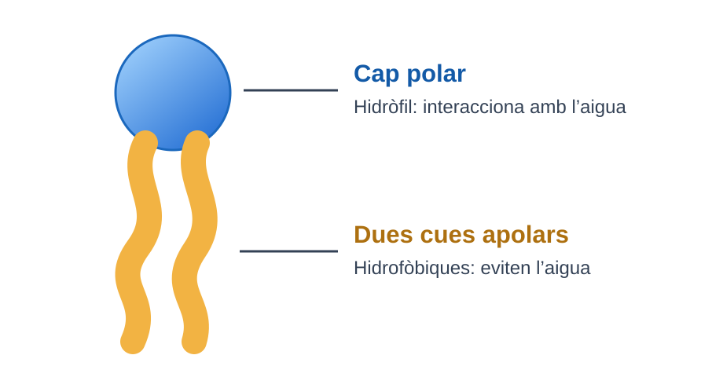
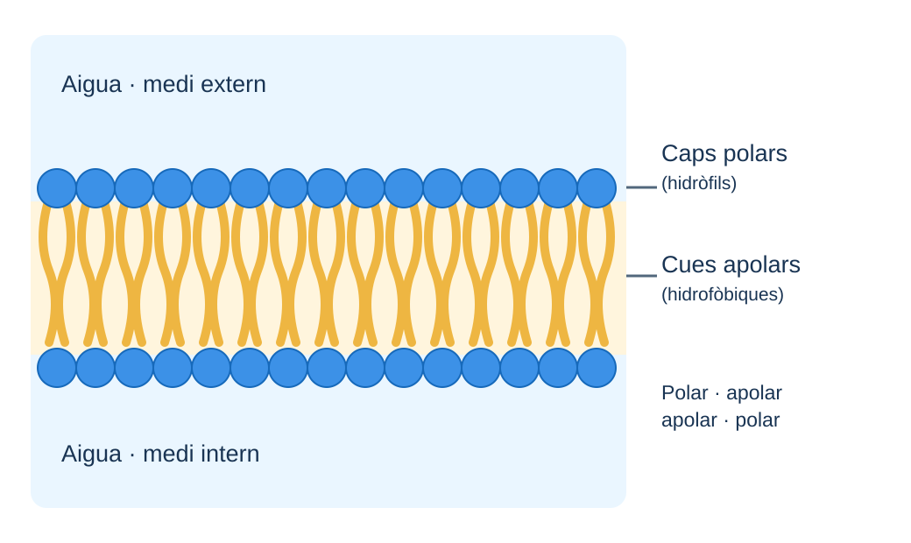
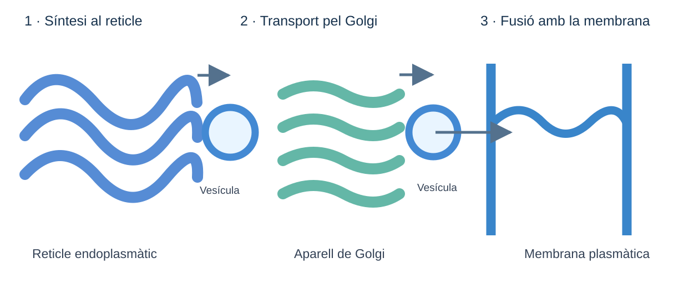

# La fina línia que sosté la vida

*Les membranes cel·lulars són extraordinàriament primes, però imprescindibles. Com les fabriquen les cèl·lules i com aconsegueixen ampliar-les?*

Una membrana plasmàtica té un gruix de només uns cinc nanòmetres. Malgrat això, separa l'interior de la cèl·lula del món exterior i regula què hi entra i què en surt.

**Però qui fabrica aquesta frontera microscòpica?**

## Els fosfolípids: molècules amb dues cares

Les membranes cel·lulars estan formades principalment per una doble capa de lípids anomenats **fosfolípids**, amb nombroses proteïnes incorporades.

Cada fosfolípid presenta dues regions amb propietats diferents:

- Un **cap polar**, que interacciona favorablement amb l'aigua. És *hidròfil*.
- Dues **cues apolars**, que tendeixen a evitar el contacte amb l'aigua. Són *hidrofòbiques*.

*Figura 1. Representació esquemàtica d'un fosfolípid, no a escala.*

Com que hi ha aigua tant dins com fora de les cèl·lules, els fosfolípids tendeixen a organitzar-se en una **bicapa**: els caps polars queden en contacte amb els medis aquosos i les cues apolars es disposen enfrontades, protegides de l'aigua.

Aquesta disposició crea una barrera que dificulta el pas directe de moltes substàncies, especialment les que tenen càrrega elèctrica, com els ions.

*Figura 2. Organització d'una bicapa fosfolipídica: polar–apolar–apolar–polar. Esquema, no a escala.*

## El reticle endoplasmàtic: una fàbrica de membranes

El **reticle endoplasmàtic** és una extensa xarxa de membranes que recorre l'interior de les cèl·lules eucariotes.

Algunes de les seves regions tenen ribosomes associats i formen el reticle endoplasmàtic rugós (RER). Altres regions constitueixen el reticle endoplasmàtic llis (REL).

Una de les funcions essencials del reticle és **fabricar bona part dels lípids que formen les membranes cel·lulars**.

A les seves membranes hi ha enzims que sintetitzen fosfolípids a partir de molècules més senzilles. Els fosfolípids nous s'incorporen a la membrana del mateix reticle i contribueixen a ampliar-la.

!!! tip "El REL és molt més que un reticle sense ribosomes"
    El REL participa en la síntesi de lípids, la transformació de determinades substàncies i la regulació del calci.

    Però **la síntesi de fosfolípids no és exclusiva del REL**: també es produeix en membranes de les regions rugoses. El REL i el RER formen part d'un mateix sistema membranós.

## De la fàbrica fins a la membrana plasmàtica

Els fosfolípids fabricats al reticle no han de quedar-s'hi necessàriament. La cèl·lula també necessita ampliar i renovar membranes d'altres compartiments.

Una de les vies principals per distribuir components de membrana és el **transport mitjançant vesícules**.

Una vesícula és un petit compartiment envoltat per una membrana. Pot formar-se quan una porció de membrana se separa d'un compartiment cel·lular.

Les vesícules poden transportar components entre el reticle endoplasmàtic, l'aparell de Golgi i la membrana plasmàtica.

*Figura 3. Síntesi de components de membrana al reticle, trànsit vesicular a través del Golgi i fusió amb la membrana plasmàtica. Esquema simplificat, no a escala.*

Quan una vesícula es fusiona amb la membrana plasmàtica, la seva membrana s'hi incorpora.

Això significa que **les vesícules no només transporten substàncies: també poden aportar lípids i proteïnes a les membranes amb què es fusionen**.

No tots els lípids es transporten en vesícules. Alguns passen directament entre membranes mitjançant proteïnes especialitzades, un mecanisme important per a orgànuls com els mitocondris.

## Què passaria si una cèl·lula no pogués fabricar prou fosfolípids?

Imagina que una cèl·lula continua produint proteïnes i altres substàncies necessàries per créixer, però la seva capacitat de fabricar fosfolípids disminueix considerablement.

La cèl·lula necessitaria ampliar les seves membranes, però no disposaria de prou materials per fer-ho amb normalitat.

Aquesta situació podria dificultar el creixement cel·lular i alterar el funcionament dels orgànuls membranosos.

El problema no afectaria només la membrana plasmàtica. **El reticle endoplasmàtic, l'aparell de Golgi i els mitocondris també necessiten mantenir i renovar les seves membranes.**

## Una cèl·lula que es construeix a si mateixa

Les membranes cel·lulars no són estructures immòbils. Els seus components es fabriquen, es transporten i es renoven contínuament.

El reticle endoplasmàtic té un paper fonamental en la síntesi de fosfolípids, mentre que les vesícules i altres mecanismes permeten distribuir lípids entre diferents membranes.

La descoberta és sorprenent: **les cèl·lules utilitzen les seves pròpies membranes per fabricar i distribuir els materials amb què construeixen més membranes**.

---

### Fonts científiques

- Cooper, G. M. *The Cell: A Molecular Approach*. «The Endoplasmic Reticulum». NCBI Bookshelf.
- Alberts i col·laboradors. *Molecular Biology of the Cell*. «The Endoplasmic Reticulum». NCBI Bookshelf.
- OpenStax. *Biology 2e*. «The Endomembrane System and Proteins».
