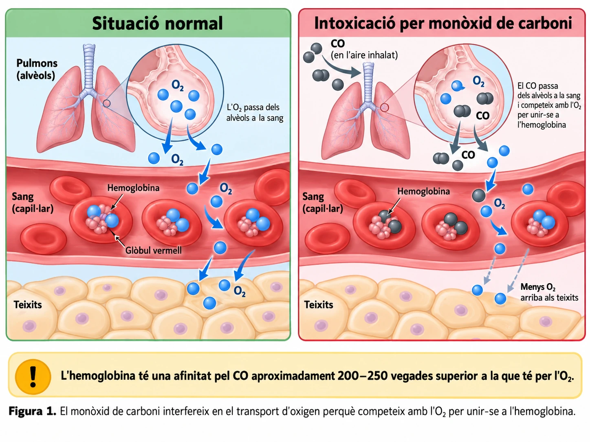
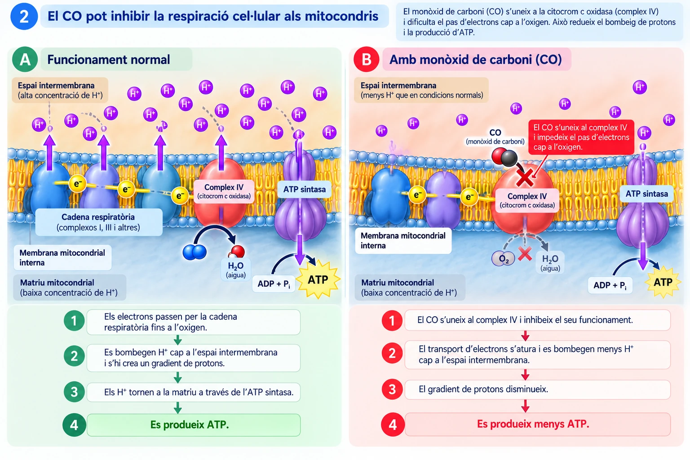

# El gas invisible que roba l'energia a les cèl·lules

*No té color ni olor, però pot impedir que l'oxigen arribi a les cèl·lules i dificultar que els mitocondris produeixin l'energia necessària per viure.*

Un mal de cap, mareig i una sensació de debilitat poden semblar símptomes poc preocupants. Però, si apareixen en un espai tancat on funciona un aparell de combustió defectuós, podrien indicar una intoxicació per **monòxid de carboni**.

Com pot un gas invisible alterar el funcionament de milions de cèl·lules?

## Un gas que no avisa

El **monòxid de carboni (CO)** es pot formar quan combustibles com el gas, la llenya o el carbó no es cremen completament.

És especialment perillós perquè no té color ni olor. Si s'acumula en un espai poc ventilat, una persona el pot respirar sense adonar-se'n.

Quan entra als pulmons, el CO passa dels alvèols a la sang, igual que ho fa l'oxigen.

Però, una vegada dins la sang, apareix el primer problema.

## L'hemoglobina: un transportador enganyat

L'oxigen que respiram viatja principalment unit a l'**hemoglobina**, una proteïna dels glòbuls vermells.

L'hemoglobina recull oxigen als pulmons i ajuda a transportar-lo fins als teixits, on les cèl·lules el necessiten.

El monòxid de carboni també es pot unir a l'hemoglobina. I ho fa amb una afinitat molt superior a la de l'oxigen.

Quan el CO ocupa els llocs d'unió de l'hemoglobina, disminueix la quantitat d'oxigen que la sang pot transportar. A més, dificulta que l'hemoglobina alliberi una part de l'oxigen que encara duu unit.

Així, **una persona pot continuar respirant, però les seves cèl·lules poden rebre menys oxigen del que necessiten**.

*Figura 1. El CO s'uneix a l'hemoglobina amb una afinitat elevada i interfereix en el transport d'oxigen cap als teixits.*

!!! info "Una competència molt desigual"
    L'hemoglobina té una afinitat pel monòxid de carboni aproximadament **200–250 vegades superior** a la que té per l'oxigen.

    Això no significa que sempre s'uneixi al CO, però explica per què una quantitat relativament petita d'aquest gas pot interferir greument en el transport d'oxigen.

## Els mitocondris necessiten oxigen

Per què és tan important que l'oxigen arribi a les cèl·lules?

Als **mitocondris** es produeix una part molt important de l'ATP que utilitzen les cèl·lules. L'ATP és una molècula que proporciona energia per dur a terme processos com el transport de substàncies, la contracció muscular o la síntesi de components cel·lulars.

Durant la **respiració cel·lular aeròbica**, les cèl·lules obtenen energia de molècules orgàniques, com la glucosa, mitjançant una sèrie de reaccions.

En una de les etapes finals, l'oxigen té una funció imprescindible: **acceptar electrons al final de la cadena respiratòria**, situada a la membrana interna dels mitocondris.

Aquest procés permet mantenir les condicions necessàries perquè es fabriqui una gran quantitat d'ATP.

Quan arriba menys oxigen, la producció mitocondrial d'ATP es pot reduir considerablement.

## Un segon atac: el CO també afecta els mitocondris

El monòxid de carboni no només interfereix en el transport d'oxigen per la sang.

També pot actuar directament sobre els mitocondris.

A la cadena respiratòria hi ha una proteïna anomenada **citocrom c oxidasa**, que participa en el pas final dels electrons cap a l'oxigen.

El CO pot unir-se a aquesta proteïna i dificultar-ne el funcionament. Això altera la cadena respiratòria i pot reduir encara més la producció d'ATP.

Per tant, la intoxicació pot afectar les cèl·lules per **dues vies relacionades**:

1. **Arriba menys oxigen als teixits**, perquè el CO interfereix en el seu transport sanguini.
2. **Els mitocondris poden tenir dificultats per utilitzar l'oxigen disponible**, perquè el CO pot inhibir una proteïna de la cadena respiratòria.

*Figura 2. El CO pot inhibir el complex IV de la cadena respiratòria. Això redueix el gradient de protons que impulsa l'ATP sintasa i, en conseqüència, disminueix la producció d'ATP. Esquema didàctic.*

És com si una fàbrica rebés menys combustible i, al mateix temps, una peça important de la maquinària deixàs de funcionar correctament.

## Per què el cervell i el cor són tan vulnerables?

No totes les cèl·lules tenen les mateixes necessitats energètiques.

Les neurones necessiten ATP contínuament per mantenir els gradients d'ions que fan possible la transmissió dels impulsos nerviosos.

Les cèl·lules musculars del cor també necessiten una aportació constant d'ATP per mantenir les contraccions que impulsen la sang.

Per això, el **cervell i el cor** són especialment vulnerables a les alteracions del transport d'oxigen i de la respiració cel·lular.

Una intoxicació per CO pot provocar mal de cap, mareig, confusió, pèrdua de consciència i, en els casos més greus, lesions permanents o la mort.

!!! tip "Un perill que es pot prevenir"
    Els aparells de combustió han de funcionar correctament i disposar de la ventilació adequada. Els detectors específics de monòxid de carboni poden advertir de la presència d'aquest gas.

    Si se sospita una intoxicació, cal **sortir immediatament a l'aire lliure, sense posar-se en perill, i avisar els serveis d'emergència (112)**. No s'ha de tornar a entrar a l'espai fins que sigui segur.

## Respirar no basta: l'oxigen ha d'arribar i s'ha de poder utilitzar

La intoxicació per monòxid de carboni revela una connexió essencial entre sistemes del nostre organisme.

Els pulmons permeten l'entrada d'oxigen. La sang el transporta. I els mitocondris l'utilitzen per produir ATP.

Si falla qualsevol d'aquestes etapes, les cèl·lules poden tenir dificultats per obtenir l'energia que necessiten.

**La vida depèn no només de respirar oxigen, sinó també de fer-lo arribar a les cèl·lules i poder-lo utilitzar.**

---

### Fonts científiques

- CDC / ATSDR. *Toxicological Profile for Carbon Monoxide*. NCBI Bookshelf.
- UK Health Security Agency. *Carbon monoxide: toxicological overview*.
- Alonso, J. R. i col·laboradors (2003). *Carbon monoxide specifically inhibits cytochrome c oxidase of human mitochondrial respiratory chain*. *Pharmacology & Toxicology*.
- OpenStax. *Biology 2e*. «Cellular Respiration».
