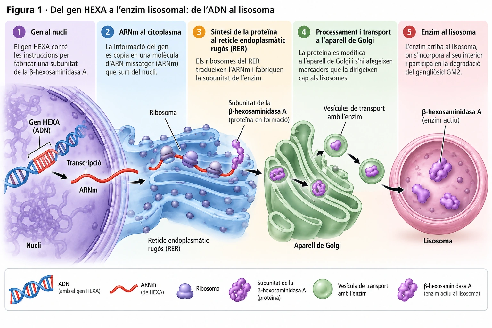
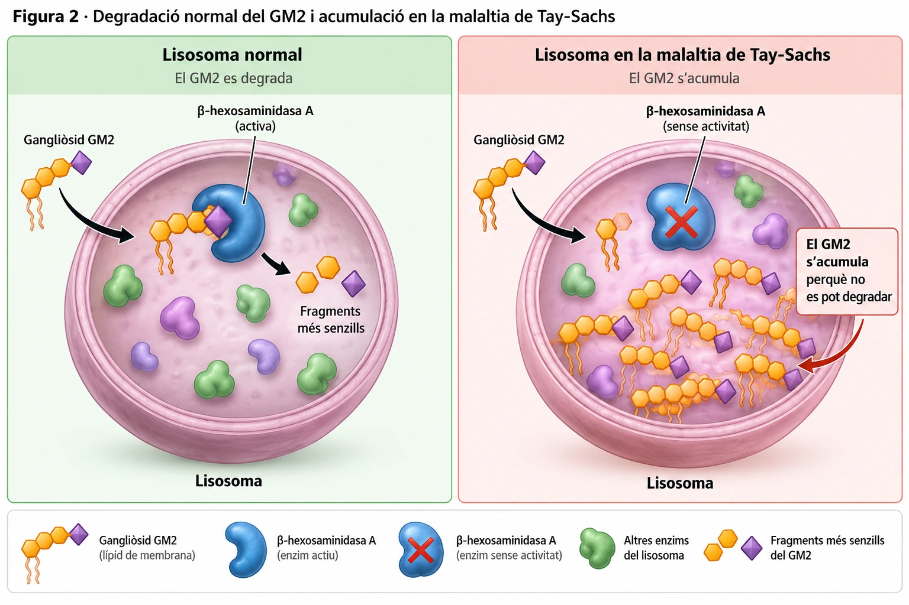

# La trampa invisible dins les neurones

*Una alteració de l'ADN pot acabar provocant l'acumulació de lípids dins les neurones. La malaltia de Tay-Sachs revela què passa quan falla una petita peça del sistema de reciclatge cel·lular.*

Durant els primers mesos de vida, alguns infants amb la malaltia de Tay-Sachs es desenvolupen aparentment amb normalitat. Després, comencen a perdre habilitats que ja havien adquirit.

La causa s'amaga dins les seves cèl·lules, en uns compartiments microscòpics encarregats de degradar i reciclar substàncies.

## Els lisosomes: el sistema de reciclatge cel·lular

Les cèl·lules fabriquen, utilitzen i renoven contínuament els seus components. Algunes molècules es deterioren, altres deixen de ser necessàries i determinades estructures han de ser substituïdes.

Una part important d'aquesta feina recau en els **lisosomes**, petits compartiments envoltats per una membrana.

Al seu interior hi ha **enzims digestius**, proteïnes capaces de descompondre substàncies complexes en fragments més senzills. Una part d'aquests fragments pot ser aprofitada de nou per la cèl·lula.

Però els lisosomes no apareixen del no-res. **La cèl·lula també ha de fabricar els components que els formen i els enzims que contenen.**

Els lípids necessaris per construir les membranes es fabriquen en bona part al **reticle endoplasmàtic**. Les proteïnes destinades als lisosomes, inclosos els seus enzims digestius, se sintetitzen als ribosomes associats al **reticle endoplasmàtic rugós (RER)**.

Després, aquestes proteïnes passen per l'**aparell de Golgi**, on es modifiquen i es distribueixen cap al seu destí. Els lisosomes es formen i maduren gràcies a aquest transport de components i a la participació d'altres compartiments, com els endosomes.

## Una instrucció alterada a l'ADN

Per fabricar un enzim, la cèl·lula necessita unes instruccions. Aquestes instruccions es troben a l'**ADN**, organitzades en fragments anomenats **gens**.

En primer lloc, la informació del gen es copia en una molècula d'**ARN missatger (ARNm)**. Després, els ribosomes llegeixen aquest missatge i el tradueixen per fabricar una proteïna.

Un dels gens implicats en el funcionament dels lisosomes és el **HEXA**.

Aquest gen conté les instruccions per fabricar una de les dues parts, o *subunitats*, d'un enzim anomenat **β-hexosaminidasa A**.

En la malaltia de Tay-Sachs, el gen *HEXA* presenta una alteració o **mutació** que pot impedir que aquesta part de l'enzim es fabriqui o funcioni correctament.

Com a conseqüència, l'activitat de la β-hexosaminidasa A és molt baixa o pràcticament nul·la.

*Figura 1. Les instruccions del gen HEXA es copien a ARNm i s'utilitzen per fabricar una subunitat de la β-hexosaminidasa A. El sistema de membranes del reticle i el Golgi participa en la seva destinació lisosomal. Esquema didàctic, no a escala.*

## Quan una substància normal es converteix en un problema

Entre els lípids de les membranes cel·lulars hi ha unes molècules anomenades **gangliòsids**, especialment abundants a les membranes de les cèl·lules nervioses.

Un d'aquests lípids és el **gangliòsid GM2**.

Quan arriba el moment de degradar-lo, la β-hexosaminidasa A participa en la seva descomposició dins els lisosomes.

Però si l'enzim no funciona correctament, **el GM2 no es pot degradar amb normalitat i comença a acumular-se**.

!!! info "No tots els lisosomes deixen de funcionar"
    En la malaltia de Tay-Sachs, els lisosomes continuen tenint molts altres enzims actius.

    El problema afecta especialment la degradació del gangliòsid GM2.

    És com tenir un taller ple d'eines, però sense la peça necessària per completar una reparació concreta.

*Figura 2. Degradació del gangliòsid GM2 en un lisosoma normal i acumulació de GM2 quan l'activitat de la β-hexosaminidasa A és insuficient. Esquema didàctic, no a escala.*

El més sorprenent és que el GM2 **no és una substància tòxica que hagi entrat de l'exterior**. És un component normal de determinades membranes.

El problema apareix quan la cèl·lula no el pot degradar adequadament.

Com que les membranes es renoven contínuament, el GM2 que no es descompon es va acumulant dins els lisosomes. Amb el temps, aquesta acumulació altera el funcionament cel·lular i pot provocar la mort de les cèl·lules afectades.

La malaltia de Tay-Sachs forma part de les anomenades **malalties d'acumulació lisosomal**.

## Per què les neurones en pateixen especialment les conseqüències?

Les neurones són cèl·lules especialitzades en rebre i transmetre informació. El seu funcionament depèn del manteniment de les membranes i de la renovació dels components cel·lulars.

En la malaltia de Tay-Sachs, l'acumulació de GM2 afecta especialment les neurones del sistema nerviós central.

En la forma infantil més greu, els primers signes solen aparèixer entre els tres i els sis mesos de vida. Poden incloure debilitat muscular, una resposta exagerada als sorolls sobtats i dificultats en el desenvolupament.

A mesura que la malaltia progressa, els infants poden perdre capacitats que ja havien adquirit. També poden aparèixer problemes de visió, dificultats per empassar i convulsions.

Existeixen formes menys freqüents que es manifesten més tard i evolucionen de manera diferent.

## Una petita alteració amb grans conseqüències

La malaltia de Tay-Sachs mostra com estan connectats processos cel·lulars que, a primera vista, podrien semblar independents.

Una alteració de l'**ADN** modifica les instruccions per fabricar una proteïna. Aquesta proteïna, sintetitzada al **reticle endoplasmàtic rugós** i transportada fins al **lisosoma**, no pot desenvolupar correctament la seva funció.

Com a resultat, una substància que normalment es degradaria comença a acumular-se i acaba perjudicant les cèl·lules.

**La vida cel·lular no depèn només de fabricar substàncies: també depèn de poder-les transformar, degradar i reciclar.**

---

### Fonts científiques

- [MedlinePlus Genetics. *Tay-Sachs disease*.](https://medlineplus.gov/genetics/condition/tay-sachs-disease/)
- [MedlinePlus Genetics. *HEXA gene*.](https://medlineplus.gov/genetics/gene/hexa/)
- [NCBI Bookshelf. *Transport from the Trans Golgi Network to Lysosomes*.](https://www.ncbi.nlm.nih.gov/books/NBK26844/)
- [NCBI Bookshelf. *Lysosomes*.](https://www.ncbi.nlm.nih.gov/books/NBK9953/)
