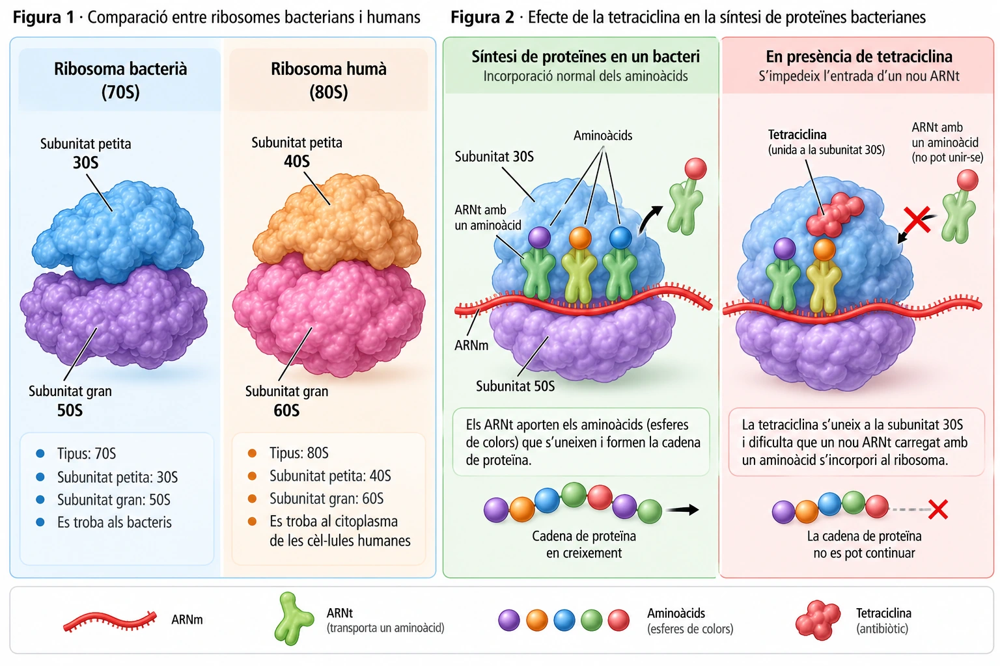

# Sabotatge a la fàbrica de proteïnes

*Alguns antibiòtics aprofiten una diferència microscòpica entre els bacteris i les nostres cèl·lules: no tots els ribosomes són iguals.*

Un bacteri pot tenir nutrients, ADN i energia i, tanmateix, deixar de créixer. Només cal que una peça essencial de la seva maquinària quedi bloquejada: el **ribosoma**.

Com pot un antibiòtic inutilitzar aquesta fàbrica sense aturar també les nostres cèl·lules?

## Una fàbrica imprescindible per a qualsevol cèl·lula

Les proteïnes fan feines essencials: actuen com a enzims, transporten substàncies, formen estructures i intervenen en nombrosos processos cel·lulars.

Per fabricar-les, les cèl·lules utilitzen els **ribosomes**, petites estructures formades per ARN ribosòmic i proteïnes.

El procés comença amb la informació continguda a l'ADN. Aquesta informació es copia en una molècula d'**ARN missatger (ARNm)**, que arriba fins a un ribosoma.

El ribosoma llegeix el missatge i, amb l'ajuda de molècules d'**ARN de transferència (ARNt)**, uneix aminoàcids en l'ordre adequat fins a formar una proteïna.

Un bacteri necessita fabricar proteïnes contínuament per mantenir-se viu, créixer i reproduir-se.

Per això, **bloquejar els seus ribosomes és una manera d'aturar una funció essencial sense necessitat de destruir directament la cèl·lula**.

## No tots els ribosomes són iguals

Tant els bacteris com les nostres cèl·lules tenen ribosomes. Però no són idèntics.

Els **ribosomes bacterians** són del tipus **70S**, formats per dues subunitats anomenades 30S i 50S.

En canvi, els ribosomes del citoplasma de les **cèl·lules humanes** són del tipus **80S**, amb subunitats 40S i 60S.

Aquestes denominacions reflecteixen propietats físiques dels ribosomes, però el més important és que **també presenten diferències en la seva estructura i composició molecular**.

!!! info "Una diferència que permet atacar selectivament"
    Alguns antibiòtics reconeixen estructures pròpies dels ribosomes bacterians i s'hi uneixen amb molta més facilitat que als ribosomes del citoplasma de les nostres cèl·lules.

    Aquesta diferència permet atacar els bacteris sense inhibir de la mateixa manera la fabricació de proteïnes de les cèl·lules humanes.

    La selectivitat, però, no és absoluta: els antibiòtics també poden tenir efectes adversos.

## La tetraciclina: una peça que bloqueja el procés

Un exemple d'aquesta estratègia és la **tetraciclina**, que pertany a una família d'antibiòtics utilitzats contra determinades infeccions bacterianes.

Quan entra en un bacteri sensible, la tetraciclina s'uneix a la **subunitat petita 30S del ribosoma**.

Per entendre'n l'efecte, hem d'observar què passa durant la fabricació d'una proteïna.

Normalment, les molècules d'ARNt arriben al ribosoma transportant aminoàcids. Cada aminoàcid nou s'incorpora a la cadena que està creixent.

La tetraciclina **dificulta que un nou ARNt carregat amb un aminoàcid s'uneixi al lloc adequat del ribosoma**.

Com a conseqüència, la cadena de proteïna no es pot continuar allargant amb normalitat.

*Figures 1 i 2. A l'esquerra, diferències entre els ribosomes bacterians i humans. A la dreta, comparació entre la síntesi normal de proteïnes en un bacteri i la inhibició de l'entrada de nous ARNt per la tetraciclina. Esquemes didàctics, no a escala.*

Si el bacteri no pot fabricar prou proteïnes, moltes de les seves activitats queden afectades.

La tetraciclina té habitualment un efecte **bacteriostàtic**: impedeix o frena el creixement i la multiplicació dels bacteris sensibles, però no necessàriament els mata de manera directa.

## Quan els bacteris aconsegueixen esquivar l'antibiòtic

La tetraciclina no és eficaç contra tots els bacteris.

Alguns tenen mecanismes que els permeten resistir-ne l'acció. Per exemple, poden disposar de **proteïnes que protegeixen els ribosomes** o de **bombes de membrana que expulsen l'antibiòtic** abans que s'acumuli en quantitat suficient.

Aquestes capacitats estan relacionades amb gens que els bacteris poden heretar o adquirir d'altres bacteris.

Quan s'utilitza un antibiòtic, els bacteris sensibles poden deixar de multiplicar-se, mentre que els resistents tenen més possibilitats de sobreviure i reproduir-se.

Així, l'ús d'antibiòtics pot afavorir la propagació dels bacteris resistents.

!!! tip "La resistència és dels bacteris, no de les persones"
    Quan deim que un antibiòtic ha deixat de funcionar contra una infecció, no significa que el cos de la persona s'hagi acostumat al medicament.

    Significa que els bacteris causants de la infecció poden tenir mecanismes que els permeten resistir-ne l'acció.

    Per això és important utilitzar els antibiòtics només quan estan indicats i seguir les instruccions del professional sanitari.

## Per què els antibiòtics no curen un refredat?

La resposta té a veure amb una diferència fonamental entre bacteris i virus.

Els **bacteris són cèl·lules**: tenen membrana plasmàtica, citoplasma, ADN i ribosomes propis.

Els **virus, en canvi, no són cèl·lules i no tenen ribosomes propis**. Per fabricar les seves proteïnes, aprofiten els ribosomes de les cèl·lules que infecten.

Un antibiòtic que bloqueja els ribosomes bacterians, per tant, **no troba aquesta mateixa diana en un virus**.

Això explica per què la tetraciclina i altres antibiòtics no serveixen per tractar infeccions víriques com els refredats o la grip.

## Una diferència microscòpica que pot salvar vides

Els ribosomes són imprescindibles per a totes les cèl·lules, però les diferències entre els bacterians i els humans permeten desenvolupar medicaments que actuen preferentment contra els bacteris.

La tetraciclina n'és un exemple: una molècula capaç de dificultar la fabricació de proteïnes i frenar la multiplicació de bacteris sensibles.

**Una petita diferència en l'estructura d'un ribosoma pot determinar si un antibiòtic és capaç d'aturar un bacteri.**

### Article 5 · Sabotatge a la fàbrica de proteïnes

**La recerca continua la lluita contra les infeccions**

La resistència bacteriana és un repte important per a la medicina, però la investigació continua desenvolupant nous antibiòtics i estratègies per detectar, prevenir i tractar les infeccions.

Conèixer les diferències entre les cèl·lules bacterianes i les humanes ajuda a descobrir noves dianes per als medicaments.

**Cada descoberta sobre el funcionament dels bacteris pot contribuir a crear tractaments més eficaços i a protegir els que ja tenim.**

---

### Fonts científiques

- [NCBI Bookshelf. *Tetracycline*. StatPearls.](https://www.ncbi.nlm.nih.gov/books/NBK549905/)
- [OpenStax. *Microbiology*. «Protein Synthesis (Translation)».](https://openstax.org/books/microbiology/pages/11-4-protein-synthesis-translation)
- [Open University. *Understanding Antibiotic Resistance*.](https://www.open.edu/openlearn/mod/oucontent/view.php?id=75460&section=2.2)
- [CDC. *Healthy Habits: Antibiotic Do's and Don'ts*.](https://www.cdc.gov/antibiotic-use/about/)
