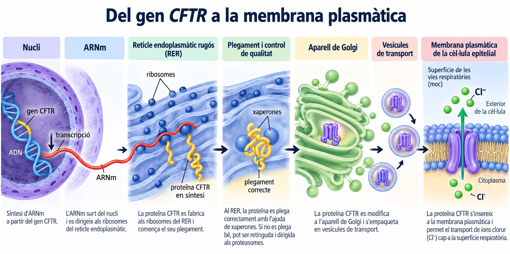
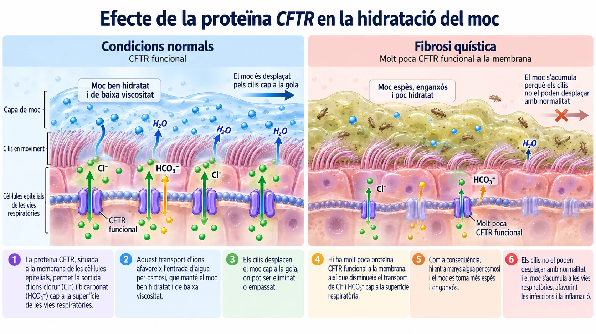

# La proteïna que no arriba mai al seu destí

*Una proteïna pot ser fabricada per una cèl·lula i, tanmateix, no arribar mai al lloc on hauria de funcionar. La fibrosi quística revela fins a quin punt el correcte funcionament dels orgànuls depèn de la coordinació entre síntesi, control de qualitat, transport i membrana plasmàtica.*

Hi ha malalties en què el problema no és que una cèl·lula no fabriqui una proteïna, sinó que la proteïna no arriba mai al seu destí final.

Això és el que passa en moltes persones amb **fibrosi quística**, una malaltia genètica que pot afectar especialment els pulmons i altres òrgans.

Per entendre-ho, hem de seguir el recorregut d'una proteïna molt concreta: la **CFTR**.

## Una proteïna destinada a la membrana

La proteïna **CFTR** és un canal de membrana que participa en el transport d'ions, especialment **clorur (Cl⁻)** i **bicarbonat (HCO₃⁻)**.

Aquesta proteïna es troba a la membrana plasmàtica de determinades **cèl·lules epitelials que entapissen les vies respiratòries**, així com d'altres teixits.

Quan funciona correctament, contribueix a regular la composició del medi que recobreix la superfície de les vies respiratòries i ajuda a mantenir el moc prou hidratat.

Però, perquè això sigui possible, la proteïna ha de completar un recorregut molt precís dins la cèl·lula.

## Del gen a la membrana plasmàtica

La informació per fabricar la proteïna CFTR es troba a l'**ADN**, en un gen anomenat **CFTR**.

Primer, aquesta informació es copia en una molècula d'**ARN missatger (ARNm)**.

Després, l'ARNm és llegit pels **ribosomes del reticle endoplasmàtic rugós (RER)**, on comença la síntesi de la proteïna.

A mesura que es fabrica, la proteïna ha d'adoptar la seva forma tridimensional correcta. Aquest procés s'anomena **plegament**.

Si tot va bé, la proteïna continua el seu recorregut cap a l'**aparell de Golgi**, on es modifica i es prepara per ser distribuïda.

Finalment, és transportada en **vesícules** fins a la **membrana plasmàtica**, on pot fer la seva funció com a canal.

*Figura 1. Síntesi, plegament i transport normal de la proteïna CFTR fins a la membrana plasmàtica d'una cèl·lula epitelial respiratòria. Esquema didàctic, no a escala.*

## Quan la proteïna CFTR no es plega correctament

En una variant freqüent de la fibrosi quística, anomenada **F508del**, la proteïna **CFTR** no es plega correctament.

El reticle endoplasmàtic no és només una fàbrica de proteïnes: també disposa d'un **sistema de control de qualitat**.

Aquest sistema comprova si les proteïnes acabades de sintetitzar han adquirit la forma adequada. Si detecta una proteïna mal plegada, pot retenir-la i impedir que continuï el seu recorregut.

Això és el que passa amb moltes proteïnes CFTR alterades: queden retingudes al reticle i són dirigides cap als **proteasomes**, estructures encarregades de degradar proteïnes que no s'han format correctament.

Per tant, la proteïna s'ha començat a fabricar, però **no aconsegueix arribar en quantitat suficient a la membrana plasmàtica**.

!!! info "Una funció que es perd abans d'arribar al seu lloc"
    En aquest cas, el problema no és només que la proteïna funcioni malament.

    El problema és que **molta proteïna CFTR ni tan sols arriba a la membrana**, perquè és detectada com a defectuosa i destruïda abans.

No totes les variants de fibrosi quística provoquen aquest mateix problema de plegament: algunes alteren la funció del canal per altres mecanismes.

## Com s'espesseix el moc?

Les vies respiratòries estan recobertes per una capa de moc. Aquest moc té una funció important: atrapa pols, microorganismes i altres partícules que entren amb l'aire.

A la superfície de les vies respiratòries també hi ha **cilis**, petites prolongacions mòbils que desplacen el moc cap a la gola, on pot ser eliminat o empassat.

Perquè aquest sistema funcioni, el moc ha d'estar **prou hidratat**.

Aquí intervé la proteïna CFTR.

Quan funciona correctament, la CFTR situada a la membrana de les cèl·lules epitelials afavoreix el transport de clorur i bicarbonat cap a la superfície respiratòria.

Aquest moviment d'ions contribueix a mantenir-hi una capa de líquid adequada. L'**aigua es desplaça per osmosi** segons les diferències de concentració de substàncies dissoltes.

Però si hi ha molt poca CFTR funcional a la membrana, disminueix el transport d'aquests ions i es redueix la hidratació de la superfície respiratòria.

Com a conseqüència, **el moc conté menys aigua i es torna més espès i enganxós**.

## Per què el moc s'acumula?

En condicions normals, els cilis desplacen contínuament el moc i ajuden a netejar les vies respiratòries.

Però quan el moc és massa espès, **els cilis ja no el poden moure amb normalitat**.

Aleshores, en lloc de ser eliminat, el moc queda retingut i **s'acumula a les vies respiratòries**.

Aquesta acumulació pot dificultar la circulació de l'aire i, a més, afavoreix que els microorganismes quedin atrapats dins el moc i siguin més difícils d'eliminar.

Per això, les persones amb fibrosi quística poden patir infeccions respiratòries repetides i inflamació pulmonar.

!!! tip "No és només una qüestió de fabricar més moc"
    El problema principal no és simplement que el cos fabriqui moc.

    El problema és que el moc està **poc hidratat**, es fa **massa dens** i el sistema que l'hauria d'eliminar deixa de funcionar bé.

    Així s'explica que el moc s'acumuli.

*Figura 2. Comparació entre una superfície respiratòria amb CFTR funcional, que manté el moc hidratat i facilita el transport ciliar, i una altra amb poca CFTR funcional, en què el moc s'espesseix i s'acumula. Esquema didàctic, no a escala.*

## Una cadena d'orgànuls que ha de funcionar coordinadament

La fibrosi quística mostra molt bé com estan connectats diversos orgànuls i estructures cel·lulars.

Una alteració al **gen CFTR** modifica les instruccions de l'ADN.

Això afecta la proteïna sintetitzada als **ribosomes del RER**.

El **reticle endoplasmàtic** detecta que la proteïna no s'ha plegat correctament i n'impedeix el pas.

Els **proteasomes** la degraden.

Com a conseqüència, no arriba prou proteïna funcional a la **membrana plasmàtica**.

Sense aquest canal, canvia el transport d'ions, es modifica el moviment d'aigua i el moc s'espesseix.

**Una petita alteració molecular pot acabar afectant el funcionament de tot un teixit.**

## Una recerca que ja està canviant vides

Comprendre el funcionament de la proteïna CFTR ha permès desenvolupar medicaments que en milloren l'activitat en moltes persones amb fibrosi quística. Aquests tractaments, juntament amb les millores en l'atenció mèdica, han contribuït a augmentar notablement la qualitat de vida i la supervivència dels pacients.

Encara no són eficaços per a totes les persones afectades, però la recerca continua avançant. Ja s'investiguen teràpies que introdueixen **ARN missatger funcional** a les cèl·lules perquè puguin fabricar la proteïna CFTR. També s'estudien diferents estratègies de **teràpia gènica**.

**Una descoberta sobre el viatge d'una proteïna dins la cèl·lula s'ha convertit en una oportunitat real per millorar moltes vides.**

---

### Fonts científiques

- [MedlinePlus Genetics. *Cystic fibrosis*.](https://medlineplus.gov/genetics/condition/cystic-fibrosis/)
- [MedlinePlus Genetics. *CFTR gene*.](https://medlineplus.gov/genetics/gene/cftr/)
- [Cystic Fibrosis Foundation. *About Cystic Fibrosis*.](https://www.cff.org/intro-cf/about-cystic-fibrosis)
- [Cystic Fibrosis Foundation. *Research on Mucus*.](https://www.cff.org/research-clinical-trials/research-mucus)
- [OpenStax. *Biology 2e*. «Passive Transport».](https://openstax.org/books/biology-2e/pages/5-2-passive-transport)
