# UD2 · La continuïtat cel·lular

<!--
MATERIAL TEÒRIC · BIOLOGIA I GEOLOGIA · 4t ESO
Versió de treball: blocs 1–4 validats provisionalment.
Les descripcions de figures es conserven en comentaris HTML per produir-les al final.
Les notes DOCENT no formen part del text d'estudi de l'alumnat.
Figures: F01–F27 i figura mestra M01. Les numeracions corresponen a l'inventari de disseny.
-->

## Bloc 1 · La diversitat cel·lular

### 1.1 · Un món de cèl·lules

Tots els éssers vius estan formats per cèl·lules. Alguns organismes, com molts bacteris i protozous, són **unicel·lulars**: una sola cèl·lula duu a terme totes les funcions vitals. Altres organismes, com els animals i les plantes, són **pluricel·lulars** i estan constituïts per nombroses cèl·lules que poden especialitzar-se en funcions diferents.

Les cèl·lules presenten formes i dimensions molt diverses. Una neurona pot tenir prolongacions llargues que li permeten comunicar-se amb altres cèl·lules; una cèl·lula muscular està adaptada a la contracció; una cèl·lula epitelial contribueix a revestir i protegir superfícies. La forma i les estructures d'una cèl·lula estan relacionades amb les funcions que desenvolupa.

La **teoria cel·lular** estableix tres idees fonamentals:

1. Tots els éssers vius estan constituïts per una o més cèl·lules.
2. La cèl·lula és la unitat bàsica d'estructura i funcionament dels éssers vius.
3. Tota cèl·lula procedeix d'una altra cèl·lula preexistent.

La tercera idea ens condueix a una de les preguntes principals de la unitat: **com es formen cèl·lules noves i com es transmet la informació necessària perquè funcionin?**

<!-- FIGURA F01 · Diversitat de cèl·lules.
Comparació d'un bacteri bacil·lar, una cèl·lula epitelial animal, una cèl·lula vegetal i una neurona. Il·lustracions científiques coherents, amb les estructures principals recognoscibles. Cada representació ha de dur la seva pròpia escala gràfica o una advertència explícita que no estan a escala; no induir comparacions de mida falses. Evitar convertir totes les cèl·lules en formes esfèriques genèriques. -->

*Figura F01. Diversitat de cèl·lules.*

### 1.2 · Què tenen en comú totes les cèl·lules?

Malgrat la seva diversitat, totes les cèl·lules comparteixen alguns components fonamentals.

La **membrana plasmàtica** delimita la cèl·lula i regula l'intercanvi de substàncies amb el medi. Està formada principalment per una bicapa de lípids amb proteïnes que participen en el transport, la comunicació i altres funcions.

El **citoplasma** comprèn el citosol —el medi aquós interior— i les estructures que conté. És l'espai on tenen lloc nombroses reaccions químiques necessàries per a la vida.

El **material genètic**, constituït per ADN en els organismes cel·lulars, conté informació necessària per al funcionament de la cèl·lula i per a la seva continuïtat.

Els **ribosomes** són estructures formades per ARN ribosòmic i proteïnes. Intervenen en la síntesi de proteïnes, imprescindibles per a l'estructura i les funcions cel·lulars.

Totes les cèl·lules duen a terme **metabolisme**, és a dir, un conjunt de transformacions químiques que els permeten obtenir i utilitzar matèria i energia.

<!-- FIGURA F02 · Components compartits.
Dues cèl·lules esquemàtiques, una bacteriana i una eucariota, amb els quatre components comuns destacats amb codis cromàtics consistents: membrana plasmàtica, citoplasma, ADN i ribosomes. Mostrar que la localització de l'ADN és diferent. Els ribosomes han de ser petits en relació amb la cèl·lula; figura no necessàriament a escala, indicant-ho. -->

*Figura F02. Components compartits.*

### 1.3 · Dues grans organitzacions cel·lulars

Segons la manera com s'organitza l'interior, distingim dos grans tipus de cèl·lules: **procariotes** i **eucariotes**.

Les **cèl·lules procariotes** no tenen un nucli delimitat per una membrana. El seu ADN es localitza principalment en una regió del citoplasma anomenada *nucleoide*. No presenten els orgànuls membranosos característics de les cèl·lules eucariotes, però poden tenir una organització interna complexa. Els bacteris i els arqueus són organismes procariotes.

Les **cèl·lules eucariotes** tenen la major part de l'ADN dins un **nucli** envoltat per un embolcall nuclear. També disposen d'un sistema de compartiments interns, molts dels quals estan delimitats per membranes: mitocondris, reticle endoplasmàtic, aparell de Golgi i altres orgànuls. Els animals, les plantes, els fongs i els protists són eucariotes.

| Característica | Procariotes | Eucariotes |
|---|---|---|
| Nucli delimitat per membrana | No | Sí |
| Localització principal de l'ADN | Nucleoide | Nucli |
| Orgànuls membranosos típics | No | Sí |
| Ribosomes | Sí | Sí |
| Mida habitual | Generalment més petites | Generalment més grans |
| Exemples | Bacteris i arqueus | Animals, plantes, fongs i protists |

Les diferències de mida són tendències generals i hi ha excepcions. Tampoc no hem de considerar les cèl·lules procariotes com a cèl·lules «incompletes»: són formes d'organització plenament funcionals i molt diverses.

<!-- FIGURA F03 · Procariota i eucariota.
Comparació d'un bacteri i una cèl·lula eucariota animal. Etiquetar nucleoide, membrana i ribosomes al bacteri, i nucli i orgànuls membranosos a l'eucariota. Distingir l'ADN del nucleoide de l'ADN nuclear. Incloure escales independents o advertiment que no estan a escala. Pot compartir base amb F02. -->

*Figura F03. Procariota i eucariota.*

### 1.4 · Cèl·lules animals i vegetals

Les cèl·lules animals i vegetals són **eucariotes**. Per això comparteixen estructures com la membrana plasmàtica, el citoplasma, el nucli, els ribosomes, els mitocondris, el reticle endoplasmàtic i l'aparell de Golgi.

Les **cèl·lules vegetals** presenten habitualment una **paret cel·lular** de composició principalment cel·lulòsica, situada a l'exterior de la membrana plasmàtica. Moltes tenen un **vacúol central** de grans dimensions que participa en l'emmagatzematge de substàncies i en el manteniment de la turgència. Les cèl·lules vegetals fotosintètiques també contenen **cloroplasts**, on es duu a terme la fotosíntesi.

Les **cèl·lules animals** no tenen paret cel·lular de cel·lulosa ni cloroplasts. La seva forma és sovint més variable, i presenten estructures especialitzades segons el teixit i la funció.

És important evitar dues generalitzacions incorrectes: **no totes les cèl·lules vegetals tenen cloroplasts** —moltes cèl·lules de les arrels, per exemple, no en tenen— i **les cèl·lules vegetals també tenen mitocondris i duen a terme respiració cel·lular**.

<!-- FIGURA F04 · Cèl·lula animal i vegetal.
Dues il·lustracions de llibre de text, comparables però no necessàriament a escala. Mostrar les estructures comunes amb colors consistents. A la vegetal, distingir clarament paret cel·lular, membrana plasmàtica, vacúol central i cloroplasts; incloure mitocondris. A l'animal, evitar dibuixar orgànuls com a estructures exclusives quan no ho són. Llegenda ordenada i etiquetes sense superposicions. -->

*Figura F04. Cèl·lula animal i vegetal.*

### 1.5 · Els orgànuls i el funcionament de la cèl·lula

Conèixer els noms, les característiques i les funcions dels orgànuls és necessari per poder explicar com cooperen.

!!! tip "Els orgànuls funcionen coordinadament"

    Les estructures cel·lulars tenen funcions específiques, però **el funcionament d'una cèl·lula depèn de la coordinació entre elles**.

| Estructura o orgànul | Funció principal |
|---|---|
| Membrana plasmàtica | Delimita la cèl·lula i regula els intercanvis i la comunicació amb l'exterior |
| Nucli | Conté la major part de l'ADN eucariota i participa en la regulació de l'activitat cel·lular |
| Ribosomes | Sintetitzen proteïnes |
| Reticle endoplasmàtic rugós | Participa en la síntesi i el processament inicial de moltes proteïnes destinades a secreció o a membranes |
| Reticle endoplasmàtic llis | Participa, entre altres funcions, en la síntesi de lípids i en la regulació del calci |
| Aparell de Golgi | Modifica, classifica i distribueix proteïnes i lípids |
| Mitocondris | Participen en la respiració cel·lular i en la producció d'ATP |
| Lisosomes | Participen en la digestió i el reciclatge de materials, especialment en cèl·lules animals |
| Vacúols | Emmagatzemen substàncies i, en plantes, contribueixen a la turgència i a altres funcions |
| Cloroplasts | Duen a terme la fotosíntesi en cèl·lules fotosintètiques |
| Citoesquelet | Dona suport a la forma, l'organització interna i el moviment cel·lular |
| Centrosoma | Participa en l'organització dels microtúbuls en moltes cèl·lules animals |

**Un exemple de funcionament coordinat: la secreció de proteïnes.**

Algunes cèl·lules del pàncrees produeixen proteïnes que han de ser alliberades a l'exterior. La informació continguda a l'ADN del nucli s'utilitza per elaborar ARN missatger. Els ribosomes associats al reticle endoplasmàtic rugós sintetitzen les proteïnes corresponents. Aquestes proteïnes passen pel reticle, es transporten en vesícules fins a l'aparell de Golgi, on poden modificar-se i classificar-se, i finalment arriben a la membrana plasmàtica dins vesícules secretores. La fusió d'aquestes vesícules amb la membrana permet alliberar-ne el contingut mitjançant **exocitosi**.

Els mitocondris contribueixen a subministrar l'ATP necessari per a molts dels processos cel·lulars implicats. No són una etapa de la ruta física que segueix la proteïna, sinó una font important d'energia per al funcionament del conjunt.

<!-- FIGURA F05 · Coordinació d'orgànuls en una cèl·lula secretora.
Esquema de nucli → ARN missatger → ribosoma del reticle endoplasmàtic rugós → transport vesicular → aparell de Golgi → vesícula secretora → membrana/exocitosi. Distingir amb fletxes de tipus diferent el flux d'informació, el transport físic de proteïnes i l'aportació d'ATP dels mitocondris. No representar els mitocondris com una estació del recorregut secretor. Figura principal de la segona sessió del bloc. -->

*Figura F05. Coordinació d'orgànuls en una cèl·lula secretora.*

**La forma i l'abundància dels orgànuls també es relacionen amb l'especialització cel·lular.** Una cèl·lula muscular que necessita molta energia pot contenir nombrosos mitocondris. Una cèl·lula especialitzada en la secreció de proteïnes acostuma a tenir un reticle endoplasmàtic rugós i un aparell de Golgi ben desenvolupats. Això no significa que els altres orgànuls siguin absents, sinó que la seva abundància relativa pot variar segons la funció.

<!-- FIGURA F06 · Especialització cel·lular.
Comparació d'una cèl·lula muscular i una cèl·lula secretora pancreàtica. Ressaltar l'abundància relativa de mitocondris a la primera i de reticle endoplasmàtic rugós/Golgi a la segona. No suggerir que un tipus cel·lular no conté els orgànuls ressaltats a l'altre. -->

*Figura F06. Especialització cel·lular.*

### 1.6 · Reconèixer i interpretar cèl·lules

Els esquemes científics són representacions simplificades que destaquen les estructures més rellevants. Les **microfotografies**, en canvi, mostren imatges obtingudes amb instruments reals i depenen de la preparació, la tinció, la resolució i el tipus de microscopi utilitzat.

!!! tip "Com interpretar una imatge cel·lular"

    Per identificar una cèl·lula, no n'hi ha prou amb memoritzar-ne la silueta. Hem de fixar-nos en les estructures observables i relacionar-les amb el model d'organització corresponent.

La presència d'un nucli delimitat és una evidència d'organització eucariota. Una paret cel·lular i cloroplasts poden orientar cap a una cèl·lula vegetal fotosintètica o una alga, segons el context. 

!!! warning "No visible no vol dir absent"

    **Que una estructura no sigui visible en una imatge no significa necessàriament que la cèl·lula no la tengui**: pot quedar fora del pla de tall, no estar tenyida o no poder resoldre's amb l'instrument.

Les dimensions també són importants. Una imatge sense escala pot resultar útil per reconèixer estructures, però no permet deduir-ne amb seguretat la mida real.

<!-- FIGURA F07 · Esquema i microfotografia.
Parelles de representacions d'una cèl·lula vegetal i una d'animal: esquema didàctic al costat de microfotografia autèntica, amb font i barra d'escala. No presentar imatges sintètiques com a microfotografies reals. Etiquetar només estructures realment identificables en la imatge corresponent. -->

*Figura F07. Esquema i microfotografia.*

<!-- DOCENT · BLOC 1
Previsió inicial: 2 sessions de 50 minuts, amb possibilitat de reserva flexible. La taula d'orgànuls és contingut per conèixer i recordar, no una llista que s'hagi d'evitar memoritzar. Progressió: recordar estructures i funcions → relacionar orgànuls → explicar processos integrats. La figura F05 pot vertebrar la segona sessió. El volum de text és material d'estudi, no un guió per llegir íntegrament en veu alta. Revisar la selecció d'orgànuls i la densitat de les figures abans de produir-les. -->

---

## Bloc 2 · La continuïtat cel·lular: d'on provenen les cèl·lules noves?

### 2.1 · Tota cèl·lula prové d'una altra cèl·lula

!!! info "Principi de la teoria cel·lular"

    **Tota cèl·lula prové d'una altra cèl·lula preexistent**.

Això significa que les cèl·lules no apareixen espontàniament. Es formen a partir de cèl·lules anteriors mitjançant processos de divisió cel·lular.

En els organismes unicel·lulars, la divisió cel·lular habitualment dona lloc a nous individus. Per exemple, molts bacteris es reprodueixen mitjançant un procés anomenat *fissió binària*, en què una cèl·lula origina dues cèl·lules descendents.

En els organismes pluricel·lulars, la divisió cel·lular permet el creixement, el desenvolupament i la renovació dels teixits. Quan una ferida cicatritza, per exemple, les divisions de determinades cèl·lules contribueixen a substituir les cèl·lules perdudes.

<!-- FIGURA F08 · La continuïtat cel·lular.
Dues seqüències paral·leles: fissió binària d'un bacteri i divisió d'una cèl·lula eucariota. Mostrar una cèl·lula inicial, la duplicació del material genètic i la formació de dues cèl·lules descendents. Diferenciar visualment els mecanismes, sense suggerir que els bacteris fan mitosi. Les fletxes representen el pas del temps. -->

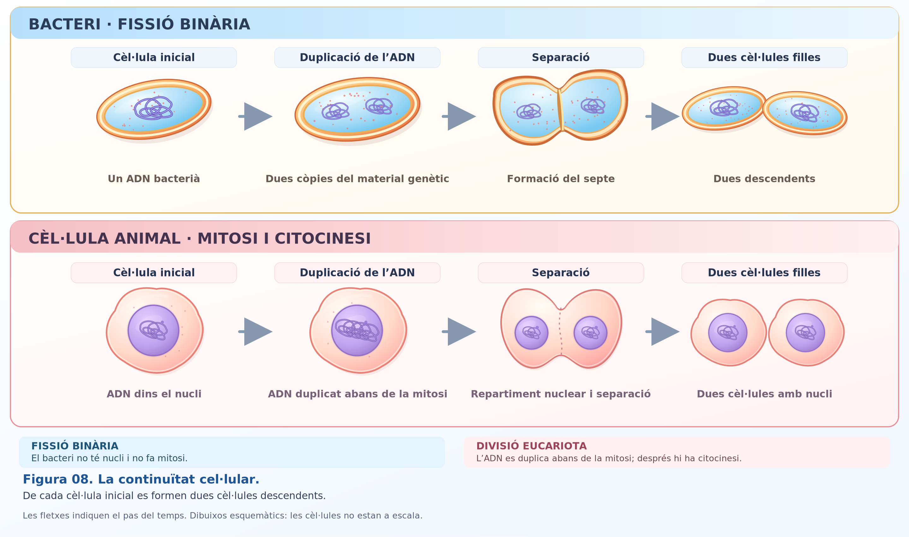

*Figura F08. La continuïtat cel·lular.*

La divisió cel·lular planteja un problema biològic fonamental: si cada cèl·lula conté informació genètica necessària per al seu funcionament, **com es garanteix que les cèl·lules descendents rebin aquesta informació?**

Per respondre aquesta pregunta, primer hem de comprendre com s'organitza el material genètic.

### 2.2 · L'ADN i els cromosomes

L'**ADN (àcid desoxiribonucleic)** és la molècula que conté la informació genètica dels organismes cel·lulars. Aquesta informació intervé en la regulació del funcionament de les cèl·lules i es transmet d'una generació cel·lular a la següent.

A les cèl·lules eucariotes, la major part de l'ADN es troba dins el nucli, associat a proteïnes. El conjunt d'ADN i proteïnes rep el nom de **cromatina**.

Quan una cèl·lula no està en divisió, la cromatina presenta un grau de compactació relativament baix i els cromosomes individuals generalment no es poden distingir amb el microscopi òptic convencional.

En canvi, quan s'inicia la divisió nuclear, els cromosomes es condensen i es fan més fàcilment observables.

Un **cromosoma** és una estructura formada per una molècula llarga d'ADN associada a proteïnes. El seu grau de compactació i el nombre de cromàtides que presenta varien durant el cicle cel·lular.

<!-- FIGURA F09 · De l'ADN als cromosomes.
Esquema progressiu que relacioni nucli, cromatina, ADN i cromosoma condensat. Incloure representacions d'un cromosoma abans i després de la duplicació de l'ADN. Evitar representar la cromatina com si només existís quan la cèl·lula no es divideix: és el material que constitueix els cromosomes en tots els moments del cicle. -->

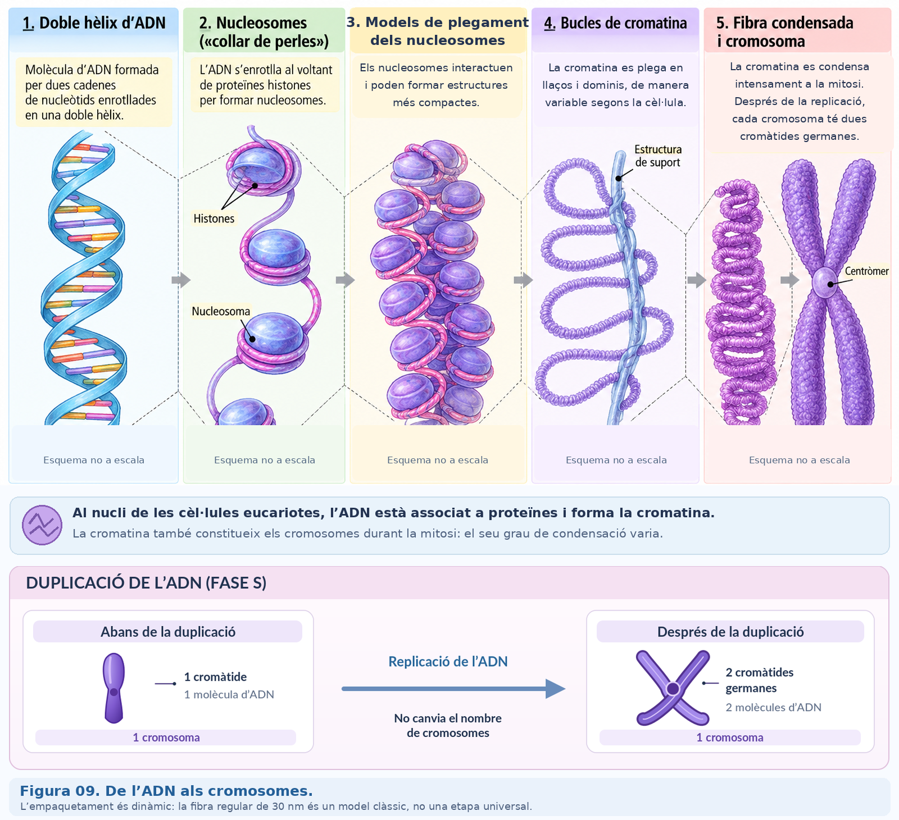

*Figura F09. De l'ADN als cromosomes.*

#### Quants cromosomes té una cèl·lula?

Cada espècie presenta habitualment un nombre característic de cromosomes.

Per exemple, les cèl·lules somàtiques humanes que tenen un nucli diploide normal contenen **46 cromosomes**, organitzats en 23 parelles.

Dels 46 cromosomes, 22 parelles són d'autosomes i una parella correspon als cromosomes sexuals.

Les cèl·lules reproductores humanes, els gàmetes, tenen habitualment 23 cromosomes. Més endavant estudiarem com la meiosi permet formar cèl·lules amb la meitat del nombre de cromosomes.

El nombre de cromosomes no indica necessàriament la complexitat d'un organisme. Hi ha organismes amb més cromosomes que els humans i d'altres amb menys.

### 2.3 · La duplicació de l'ADN

Abans de dividir-se, una cèl·lula que ha de transmetre una còpia completa del seu genoma a cadascuna de les cèl·lules descendents necessita duplicar l'ADN.

!!! info "Replicació de l'ADN"

    La duplicació de l'ADN rep el nom de **replicació de l'ADN**.

Durant la replicació, cada molècula d'ADN es copia i es formen dues molècules que, si no hi ha errors, contenen la mateixa informació genètica.

Després de la duplicació, cada cromosoma està format per dues **cromàtides germanes**, unides a la regió del centròmer. Cada cromàtide conté una molècula d'ADN.

!!! warning "Duplicar l'ADN no duplica el nombre de cromosomes"

    És important distingir entre duplicar l'ADN i duplicar el nombre de cromosomes.

<!-- FIGURA F10 · La duplicació d'un cromosoma.
A l'esquerra, un cromosoma no duplicat amb una cromàtide; al centre, fletxa de replicació; a la dreta, cromosoma duplicat amb dues cromàtides germanes. Etiquetar centròmer. A sota: «1 cromosoma, 1 molècula d'ADN» i «1 cromosoma, 2 molècules d'ADN». Advertir que les formes rectes o en X són esquemes, no configuracions constants. -->

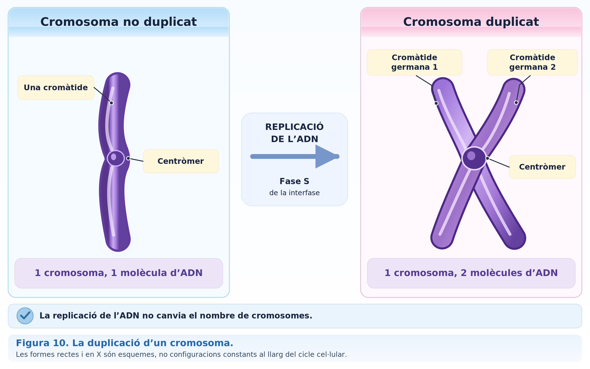

*Figura F10. La duplicació d'un cromosoma.*

Considerem una cèl·lula humana amb 46 cromosomes.

Abans de la duplicació, cada cromosoma està format per una cromàtide. Després de duplicar l'ADN, continua havent-hi 46 cromosomes, però cadascun està format per dues cromàtides germanes.

| Situació | Cromosomes | Cromàtides | Molècules d'ADN nuclear |
|---|---:|---:|---:|
| Abans de la duplicació | 46 | 46 | 46 |
| Després de la duplicació | 46 | 92 | 92 |

Aquesta taula descriu una cèl·lula somàtica humana diploide típica i considera els cromosomes nuclears.

**La duplicació de l'ADN augmenta la quantitat d'ADN, però no el nombre de cromosomes.**

Durant la divisió, les cromàtides germanes se separaran i es distribuiran entre els nuclis descendents. Quan se separen, cadascuna passa a considerar-se un cromosoma independent.

Aquesta distinció serà essencial per comprendre la mitosi.

### 2.4 · El cicle cel·lular

Les cèl·lules no es divideixen contínuament. Durant la seva existència passen per diferents etapes que constitueixen el **cicle cel·lular**.

En una cèl·lula eucariota que es divideix, el cicle comprèn dues grans fases: la interfase i la fase M.

#### La interfase

La **interfase** és el període comprès entre dues divisions cel·lulars. Durant aquesta etapa, la cèl·lula desenvolupa les seves funcions, creix i es prepara per dividir-se.

Es distingeixen tres fases principals:

- **G1:** la cèl·lula creix, sintetitza substàncies i desenvolupa les seves activitats habituals.
- **S:** es produeix la replicació de l'ADN.
- **G2:** la cèl·lula continua creixent, comprova determinats aspectes de la duplicació i es prepara per a la divisió.

Algunes cèl·lules poden abandonar temporalment o permanentment el cicle de divisió i entrar en un estat anomenat **G0**, en què continuen desenvolupant funcions especialitzades sense dividir-se.

#### La fase M

La fase M comprèn la divisió del nucli, anomenada **mitosi** en el cicle mitòtic, i habitualment la divisió del citoplasma, anomenada **citocinesi**.

Durant la mitosi, els cromosomes duplicats es distribueixen en dos nuclis descendents.

Durant la citocinesi, el citoplasma es divideix i es formen dues cèl·lules filles.

<!-- FIGURA F11 · El cicle cel·lular.
Diagrama circular G1 → S → G2 → M. Agrupar G1, S i G2 dins «interfase». Sortida opcional de G1 cap a G0. Diferenciar duplicació de l'ADN a S i distribució cromosòmica a M. Les proporcions dels sectors són orientatives, no durades universals. -->

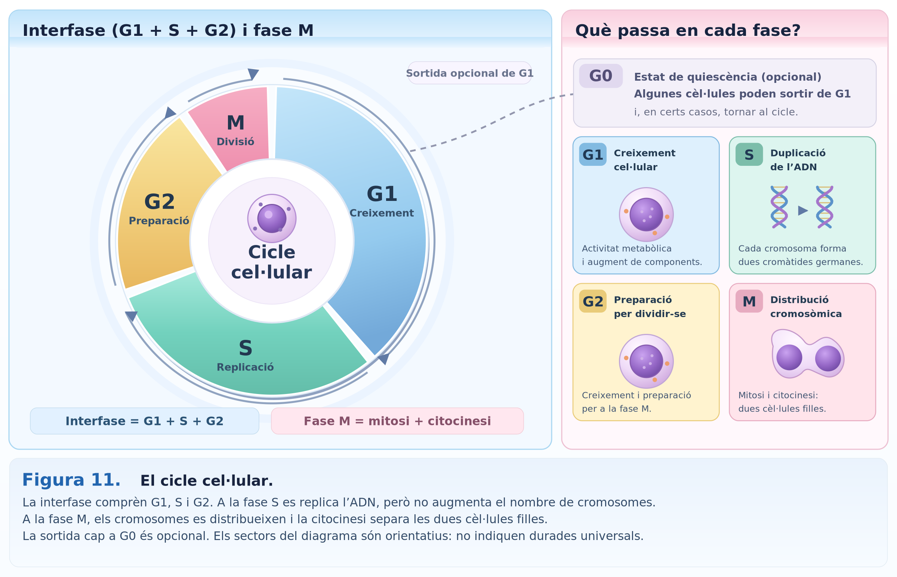

*Figura F11. El cicle cel·lular.*

La durada del cicle cel·lular varia segons el tipus de cèl·lula i les condicions en què es troba. Algunes cèl·lules es divideixen amb freqüència, mentre que d'altres poden passar molt de temps sense dividir-se.

El cicle cel·lular està regulat per mecanismes que controlen si la cèl·lula està preparada per avançar d'una fase a la següent. Aquests mecanismes contribueixen a evitar divisions amb errors importants en l'ADN o en la seva distribució.

### 2.5 · Per què és necessari controlar la divisió cel·lular?

La divisió cel·lular ha de coordinar diversos processos: el creixement de la cèl·lula, la duplicació de l'ADN, la distribució dels cromosomes i la separació del citoplasma.

Si aquests processos no es produeixen correctament, les cèl·lules descendents poden rebre una quantitat inadequada de material genètic o presentar alteracions en el seu funcionament.

En els organismes pluricel·lulars, la divisió cel·lular també ha d'estar coordinada amb les necessitats dels teixits.

Per exemple, les cèl·lules de determinats teixits es divideixen per substituir cèl·lules mortes o danyades. En canvi, moltes neurones madures no es divideixen habitualment.

Quan els mecanismes que regulen el creixement i la divisió cel·lular s'alteren, algunes cèl·lules poden començar a proliferar de manera descontrolada. Aquest fenomen és una de les característiques del **càncer**, encara que el desenvolupament d'un tumor implica altres alteracions biològiques.

<!-- FIGURA F12 · Divisió i renovació dels teixits.
Tall simplificat d'un epiteli en renovació, amb cèl·lules que es divideixen a la zona basal i altres que es diferencien i es desplacen cap a la superfície. No mostrar totes les cèl·lules del teixit dividint-se. Si s'escull un epiteli intestinal, respectar-ne l'organització histològica. -->

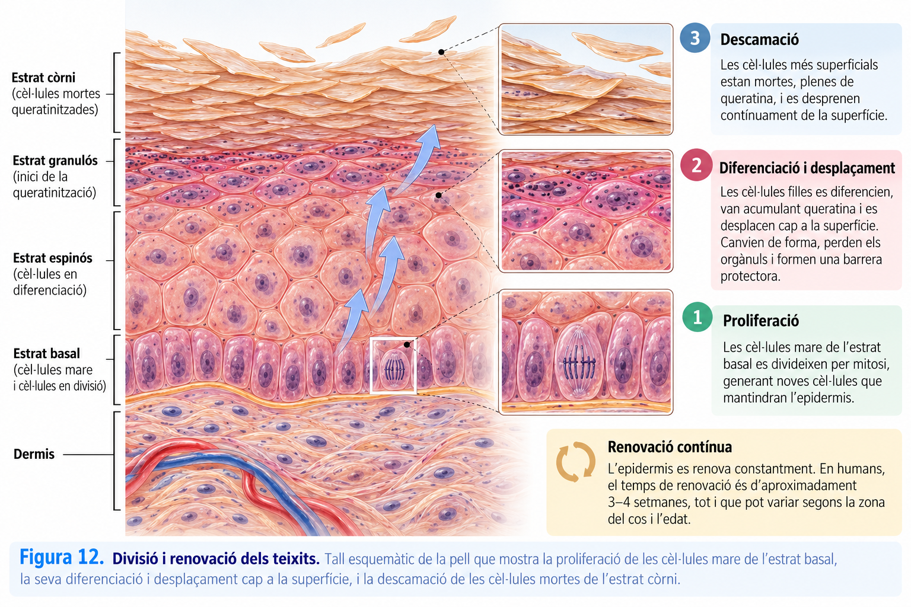

*Figura F12. Divisió i renovació dels teixits.*

#### Síntesi del bloc 2

En el cicle mitòtic típic d'una cèl·lula eucariota, la interfase inclou el creixement i la duplicació de l'ADN; la mitosi distribueix els cromosomes entre dos nuclis, i la citocinesi separa el citoplasma per formar dues cèl·lules filles. Aquest esquema no descriu totes les formes de divisió cel·lular.

<!-- DOCENT · BLOC 2
Previsió orientativa: 1 sessió, però el text és material de consulta i no cal exposar-lo íntegrament en veu alta. Prioritzar cromosoma/cromàtide/molècula d'ADN, duplicació i cicle. Figures clau F09–F11. La replicació s'introdueix funcionalment; el mecanisme molecular detallat correspon a la UD3. La separació conceptual entre cicle i mitosi modifica el repartiment inicial de sessions: revisar viabilitat temporal quan es tanqui la seqüència. -->

---

## Bloc 3 · La mitosi: com es reparteixen els cromosomes?

En el bloc anterior hem estudiat que, abans de dividir-se, una cèl·lula duplica l'ADN durant la fase S del cicle cel·lular. Ara estudiarem què succeeix amb els cromosomes duplicats i com es distribueixen entre els dos nuclis descendents.

**Com pot una cèl·lula originar dues cèl·lules filles que conservin el mateix nombre de cromosomes i, habitualment, la mateixa informació genètica?**

### 3.1 · Què és la mitosi?

La **mitosi** és el procés de divisió del nucli de les cèl·lules eucariotes mitjançant el qual els cromosomes prèviament duplicats es distribueixen en dos nuclis descendents.

En una mitosi normal, cadascun dels nuclis resultants rep una còpia de cada cromosoma de la cèl·lula inicial. D'aquesta manera, es conserva el nombre de cromosomes i, si no s'han produït alteracions, la informació genètica.

La mitosi forma part de la fase M del cicle cel·lular i habitualment va acompanyada de la **citocinesi**, que consisteix en la divisió del citoplasma.

Per tant, hem de distingir dos processos:

- **Mitosi:** divisió del nucli i distribució dels cromosomes.
- **Citocinesi:** divisió del citoplasma i separació de les dues cèl·lules filles.

La mitosi no és el mateix que la duplicació de l'ADN. Quan comença la mitosi, l'ADN ja s'ha duplicat durant la interfase.

<!-- FIGURA F13 · De la cèl·lula inicial a les dues cèl·lules filles.
Tres moments: cèl·lula amb cromosomes duplicats, distribució en dos nuclis i separació de les cèl·lules filles. Model 2n = 4, dos colors per diferenciar homòlegs. Cada nucli final ha de contenir quatre cromosomes. La duplicació de l'ADN ha de quedar clarament situada abans de la mitosi. Derivar de M01. -->

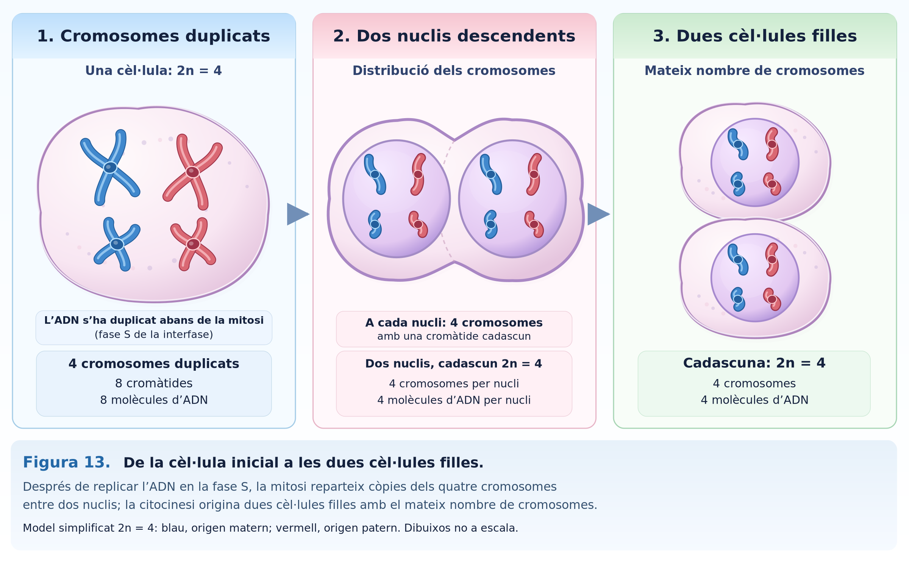

*Figura F13. De la cèl·lula inicial a les dues cèl·lules filles.*

### 3.2 · Els cromosomes abans de la mitosi

Durant la fase S de la interfase, l'ADN es replica. Com a resultat, cada cromosoma queda constituït per dues cromàtides germanes.

Les cromàtides germanes són les dues còpies d'un cromosoma duplicat. Contenen, en principi, la mateixa informació genètica i romanen unides fins al moment de la seva separació.

La regió del cromosoma on es localitza el centròmer és essencial per a la correcta distribució dels cromosomes. En aquesta regió es formen unes estructures proteiques anomenades **cinetocors**, que permeten la unió dels microtúbuls encarregats de moure els cromosomes.

Quan els cromosomes es condensen durant la mitosi, les dues cromàtides germanes poden observar-se com dues estructures allargades unides a la regió del centròmer.

**Un cromosoma duplicat continua comptant com un sol cromosoma mentre les cromàtides germanes romanen unides.**

<!-- FIGURA F14 · Anatomia d'un cromosoma duplicat.
Ampliació de dues cromàtides germanes, centròmer i cinetocors. Representar microtúbuls connectats als cinetocors des de costats oposats. Distingir centròmer (regió cromosòmica) de cinetocor (estructura proteica). Simplificar els detalls moleculars. -->

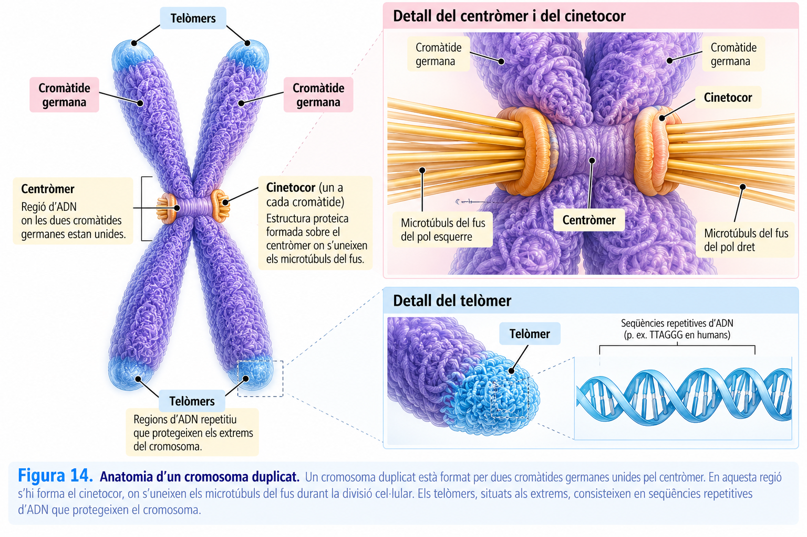

*Figura F14. Anatomia d'un cromosoma duplicat.*

#### Cromosomes homòlegs i cromàtides germanes

A les cèl·lules diploides, els cromosomes es troben organitzats en parelles de **cromosomes homòlegs**.

Els dos cromosomes d'una parella homòloga tenen els mateixos gens situats en posicions corresponents, encara que poden presentar variants diferents d'aquests gens, anomenades *al·lels*.

En un organisme que es reprodueix sexualment, habitualment un cromosoma de cada parella procedeix del progenitor matern i l'altre del patern.

No hem de confondre els cromosomes homòlegs amb les cromàtides germanes.

| | Cromosomes homòlegs | Cromàtides germanes |
|---|---|---|
| Què són? | Dos cromosomes d'una mateixa parella | Les dues còpies d'un cromosoma duplicat |
| Informació genètica | Mateixos gens, però poden tenir al·lels diferents | Inicialment, informació pràcticament idèntica |
| Origen | Habitualment un de cada progenitor | Replicació d'un mateix cromosoma |
| Durant la mitosi | No s'aparellen per separar-se conjuntament | Se separen durant l'anafase |

Aquesta distinció serà especialment important quan estudiem la meiosi.

<!-- FIGURA F15 · Homòlegs i cromàtides germanes.
Una parella de cromosomes homòlegs duplicats: un blau i un vermell. Cada cromosoma té dues cromàtides germanes inicialment del mateix color. Etiquetar parella d'homòlegs i cromàtides germanes. Reservar el codi cromàtic per a meiosi. Derivar de M01. -->

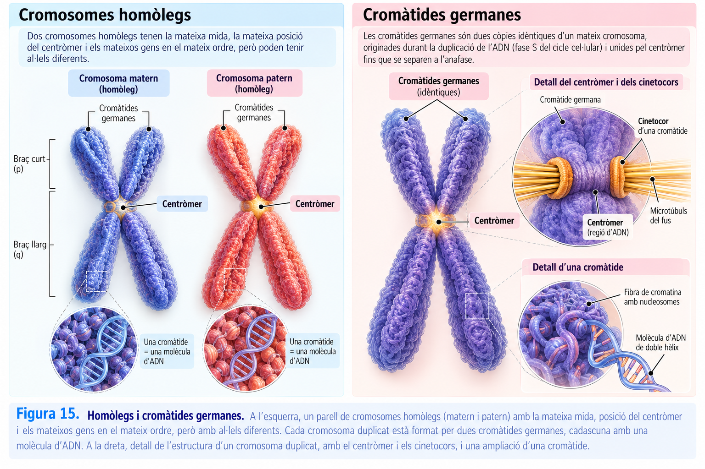

*Figura F15. Homòlegs i cromàtides germanes.*

### 3.3 · El fus mitòtic: el mecanisme que distribueix els cromosomes

La distribució dels cromosomes durant la mitosi depèn d'una estructura formada principalment per microtúbuls, anomenada **fus mitòtic**.

Els microtúbuls són components del citoesquelet constituïts per proteïnes. Poden créixer, escurçar-se i reorganitzar-se, cosa que permet generar moviments a l'interior cel·lular.

Durant la mitosi, els microtúbuls del fus s'organitzen entre dos pols de la cèl·lula.

Alguns microtúbuls s'uneixen als cinetocors dels cromosomes. Aquesta unió permet que els cromosomes es col·loquin correctament i que, posteriorment, les cromàtides germanes es distribueixin cap als pols oposats.

Altres microtúbuls contribueixen a mantenir l'organització del fus i a separar-ne els pols.

En moltes cèl·lules animals, els centrosomes participen en l'organització del fus mitòtic. Les cèl·lules vegetals també formen un fus mitòtic, encara que habitualment no tenen els centrosomes amb centríols característics de moltes cèl·lules animals.

<!-- FIGURA F16 · El fus mitòtic.
Cèl·lula animal en metafase amb dos pols, microtúbuls del fus, cromosomes alineats i cinetocors. Distingir microtúbuls cinetocòrics dels altres. Mostrar connexió de les dues cromàtides germanes amb pols oposats. No dibuixar cromosomes desconnectats del fus. -->

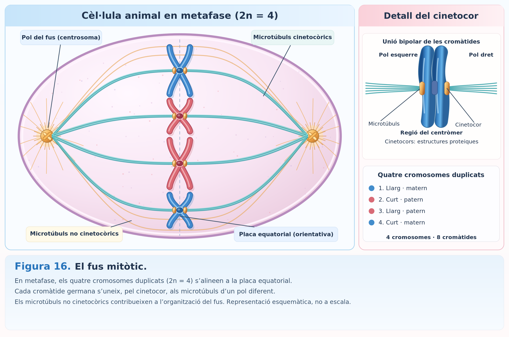

*Figura F16. El fus mitòtic.*

### 3.4 · Les fases de la mitosi

Per facilitar-ne l'estudi, la mitosi es divideix en diverses fases.

!!! note "Les fases són una convenció d'estudi"

    Aquestes fases no són processos independents, sinó etapes successives d'un procés continu.

#### Profase

Durant la **profase**, la cromatina es condensa progressivament i els cromosomes es fan visibles com a estructures diferenciades.

Cada cromosoma està format per dues cromàtides germanes, perquè l'ADN ja s'ha duplicat.

Al mateix temps, comença a organitzar-se el fus mitòtic i, en moltes cèl·lules animals, els centrosomes es desplacen cap a pols oposats.

#### Prometafase

Durant la **prometafase**, l'embolcall nuclear es desorganitza i els microtúbuls del fus poden establir connexions amb els cinetocors dels cromosomes.

Els cromosomes comencen a moure's fins a assolir la disposició característica de la metafase.

En alguns esquemes escolars, la prometafase s'inclou dins la profase. Aquí la distingirem perquè permet explicar millor com els cromosomes entren en contacte amb el fus mitòtic.

#### Metafase

Durant la **metafase**, els cromosomes duplicats es disposen aproximadament en el pla equatorial de la cèl·lula, formant l'anomenada *placa metafàsica*.

Les cromàtides germanes de cada cromosoma estan connectades, mitjançant els seus cinetocors, amb microtúbuls procedents de pols oposats.

Aquesta disposició és fonamental perquè, quan se separin les cromàtides, cadascuna es dirigeixi cap a un pol diferent.

#### Anafase

Durant l'**anafase**, es trenca la unió que mantenia juntes les cromàtides germanes.

A partir d'aquest moment, cada cromàtide es considera un cromosoma independent.

Els cromosomes resultants es desplacen cap als pols oposats del fus mitòtic. Al mateix temps, els pols poden allunyar-se entre si.

Així, cadascun dels dos grups de cromosomes rep una còpia de cada cromosoma que tenia la cèl·lula abans de la duplicació.

#### Telofase

Durant la **telofase**, els cromosomes arriben als pols i comencen a descondensar-se.

Es reorganitzen els embolcalls nuclears al voltant dels dos conjunts de cromosomes i es formen dos nuclis descendents.

El fus mitòtic es desmunta progressivament.

<!-- FIGURA F17 · Les fases de la mitosi.
Figura principal: profase, prometafase, metafase, anafase i telofase d'una cèl·lula animal 2n = 4. Mantenir la identitat dels quatre cromosomes i el mateix codi cromàtic a tota la seqüència. A l'anafase han d'anar quatre cromosomes cap a cada pol, no quatre en total. Mostrar embolcall nuclear, fus i cromàtides correctament. Derivar de M01. -->

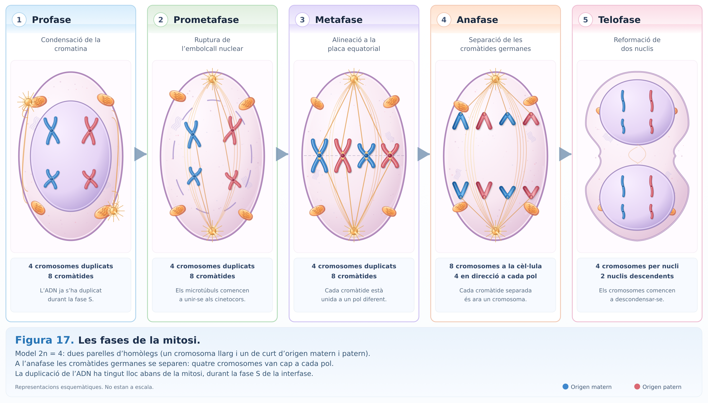

*Figura F17. Les fases de la mitosi.*

| Fase | Esdeveniment principal |
|---|---|
| Profase | Condensació dels cromosomes i organització inicial del fus |
| Prometafase | Desorganització de l'embolcall nuclear i unió dels microtúbuls als cinetocors |
| Metafase | Alineació dels cromosomes al pla equatorial |
| Anafase | Separació de les cromàtides germanes i desplaçament cap als pols |
| Telofase | Formació dels dos nuclis descendents |

Conèixer i recordar les fases és necessari, però també ho és comprendre **què canvia d'una fase a la següent i per què aquests canvis permeten repartir correctament els cromosomes**.

### 3.5 · La citocinesi: la separació de les cèl·lules filles

La mitosi acaba amb la formació de dos nuclis descendents. Per completar la divisió cel·lular habitualment també s'ha de dividir el citoplasma.

!!! info "Mitosi i citocinesi no són el mateix"

    La divisió del citoplasma s'anomena **citocinesi**. La mitosi correspon a la divisió nuclear.

#### Citocinesi en cèl·lules animals

En moltes cèl·lules animals, la membrana plasmàtica forma un solc de divisió que s'aprofundeix progressivament.

Aquest estrenyiment és produït per un anell contràctil format principalment per filaments d'actina i miosina.

Finalment, el citoplasma se separa i es formen dues cèl·lules filles.

#### Citocinesi en cèl·lules vegetals

En les cèl·lules vegetals, la presència d'una paret cel·lular rígida impedeix que la divisió es produeixi mitjançant un estrenyiment equivalent.

En lloc d'això, es forma una **placa cel·lular** a la regió central de la cèl·lula, a partir de la fusió de vesícules.

La placa creix fins a connectar amb la superfície cel·lular i contribueix a formar les noves membranes plasmàtiques i la paret que separarà les dues cèl·lules filles.

<!-- FIGURA F18 · Citocinesi animal i vegetal.
Dues seqüències paral·leles: animal amb anell contràctil i solc de divisió; vegetal amb placa cel·lular que creix per fusió de vesícules. Diferenciar membrana i paret. Mostrar dos nuclis descendents. La placa vegetal no és una paret preexistent que es desplaça. -->

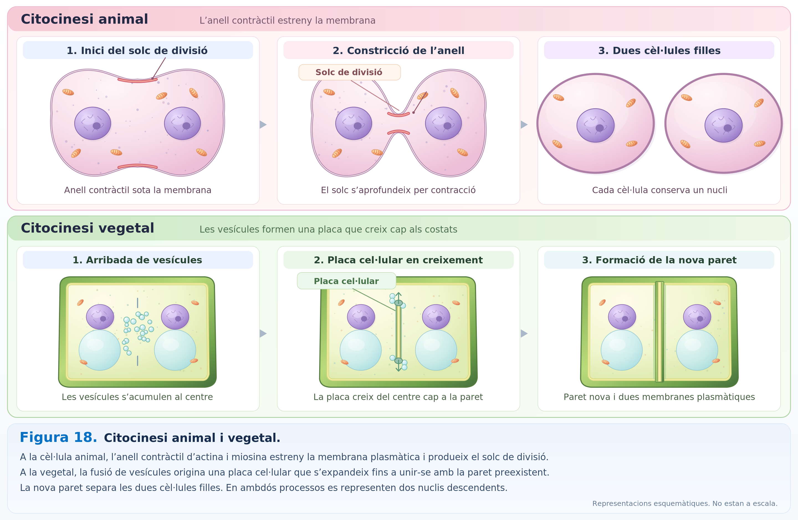

*Figura F18. Citocinesi animal i vegetal.*

### 3.6 · Què succeeix amb el nombre de cromosomes?

!!! tip "Què conserva la mitosi?"

    Una de les característiques fonamentals de la mitosi és que conserva el nombre de cromosomes dels nuclis descendents.

Considerem una cèl·lula diploide amb quatre cromosomes, és a dir, **2n = 4**.

Abans de la replicació de l'ADN, la cèl·lula té quatre cromosomes, cadascun amb una cromàtide.

Després de la replicació, continua tenint quatre cromosomes, però cadascun està format per dues cromàtides germanes.

Durant l'anafase, les cromàtides germanes se separen i passen a considerar-se cromosomes independents. En aquest moment, dins una mateixa cèl·lula que encara no ha completat la divisió, hi ha temporalment vuit cromosomes, distribuïts en dos grups de quatre.

En acabar la mitosi i la citocinesi, cada cèl·lula filla té quatre cromosomes.

| Moment | Cromosomes en la cèl·lula | Cromàtides o molècules d'ADN nuclear |
|---|---:|---:|
| G1, abans de replicar l'ADN | 4 | 4 |
| G2, després de replicar l'ADN | 4 | 8 |
| Metafase | 4 | 8 |
| Anafase, després de la separació | 8 | 8 |
| Cada cèl·lula filla, després de la citocinesi | 4 | 4 |

Després de l'anafase, les vuit estructures d'ADN ja són cromosomes independents; no s'han de comptar com a cromàtides germanes encara unides.

<!-- FIGURA F19 · Seguiment dels cromosomes durant la mitosi.
Model 2n = 4 en quatre moments: abans de duplicar, després de duplicar, anafase i dues cèl·lules filles. Conservar identitat de cada cromosoma amb colors i marques. Afegir recomptes de cromosomes i molècules d'ADN, coherents amb la taula. Reutilitzable a CEL-02. Derivar de M01. -->

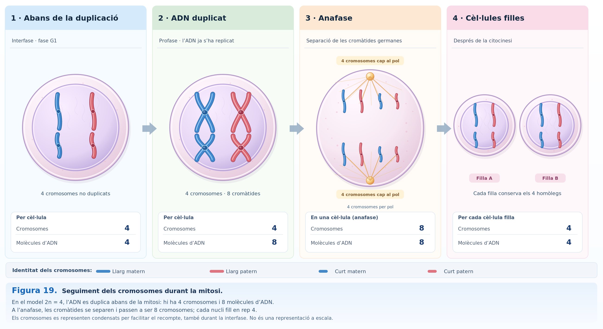

*Figura F19. Seguiment dels cromosomes durant la mitosi.*

La mitosi no redueix a la meitat el nombre de cromosomes. La reducció cromosòmica és característica de la meiosi, que estudiarem al bloc següent.

### 3.7 · Quina és la funció biològica de la mitosi?

La mitosi permet produir nuclis descendents que conserven, en condicions normals, el mateix nombre de cromosomes i una informació genètica equivalent a la del nucli inicial.

Aquesta capacitat té diferents funcions biològiques.

**Creixement i desenvolupament.** En els organismes pluricel·lulars, les divisions mitòtiques contribueixen a augmentar el nombre de cèl·lules. El desenvolupament d'un organisme a partir d'una única cèl·lula inicial implica nombroses divisions i processos de diferenciació.

**Renovació i reparació.** Molts teixits substitueixen cèl·lules que moren o resulten danyades. Les divisions de cèl·lules progenitores permeten mantenir o reparar aquests teixits.

**Reproducció asexual.** En nombrosos eucariotes unicel·lulars i en determinats processos de reproducció asexual d'organismes pluricel·lulars, la mitosi participa en la producció de nous individus.

Les cèl·lules filles produïdes per mitosi solen ser genèticament molt semblants entre si i a la cèl·lula inicial. No obstant això, poden aparèixer diferències a causa de mutacions o altres alteracions.

Per tant, és més precís afirmar que la mitosi **tendeix a conservar la informació genètica** que no assegurar que sempre produeix cèl·lules absolutament idèntiques.

#### Síntesi del bloc 3

La duplicació de l'ADN té lloc abans de la mitosi. Durant la profase i la prometafase, els cromosomes es condensen i s'organitza la seva connexió amb el fus; a la metafase s'alineen; a l'anafase se separen les cromàtides germanes; a la telofase es formen dos nuclis. La citocinesi completa habitualment la separació en dues cèl·lules filles amb el mateix nombre de cromosomes que la inicial.

<!-- DOCENT · BLOC 3
Previsió orientativa: 2 sessions. Conceptes essencials: fases i ordre, comportament cromosòmic, fus, diferència mitosi/citocinesi, recomptes i funció. Prometafase i cinetocors permeten precisió, però no han de pesar necessàriament igual en la prova. La figura F17 és referent previ a la microscòpia; les microfotografies reals són menys netes. Figures F15 i F19 han de compartir codi cromàtic amb la meiosi i M01. -->

---

## Bloc 4 · La meiosi: com es formen cèl·lules amb la meitat de cromosomes?

En el bloc anterior hem estudiat que la mitosi permet conservar el nombre de cromosomes. Però la reproducció sexual planteja un problema diferent.

Si dues cèl·lules reproductores amb el nombre complet de cromosomes s'unissin durant la fecundació, el nombre de cromosomes es duplicaria en cada generació.

Per evitar-ho, els organismes amb reproducció sexual disposen de mecanismes que redueixen el nombre de cromosomes abans de la fecundació. Un d'aquests mecanismes és la **meiosi**.

### 4.1 · El problema de la reproducció sexual

En els éssers humans, la majoria de les cèl·lules del cos tenen 46 cromosomes, organitzats en 23 parelles.

Aquestes cèl·lules són **diploides (2n)** perquè contenen dos conjunts de cromosomes. En cada parella, habitualment un cromosoma procedeix del progenitor matern i l'altre del patern.

En canvi, els gàmetes humans —òvuls i espermatozoides— tenen 23 cromosomes, un de cada parella. Són cèl·lules **haploides (n)**.

Durant la fecundació, la fusió dels gàmetes permet recuperar el nombre diploide de cromosomes:

$$n+n=2n$$

En l'espècie humana:

$$23+23=46$$

D'aquesta manera, el nombre de cromosomes es manté estable entre generacions, encara que la informació genètica es combina de maneres diferents.

La meiosi és el procés de divisió nuclear que permet reduir el nombre de cromosomes de diploide a haploide.

<!-- FIGURA F20 · Meiosi i fecundació.
Cicle reproductor humà simplificat: cèl·lula diploide de línia germinal 2n = 46 → meiosi → gàmetes n = 23 → fecundació → zigot 2n = 46 → creixement per mitosi. No mostrar cèl·lula somàtica qualsevol transformant-se directament en gàmetes. -->

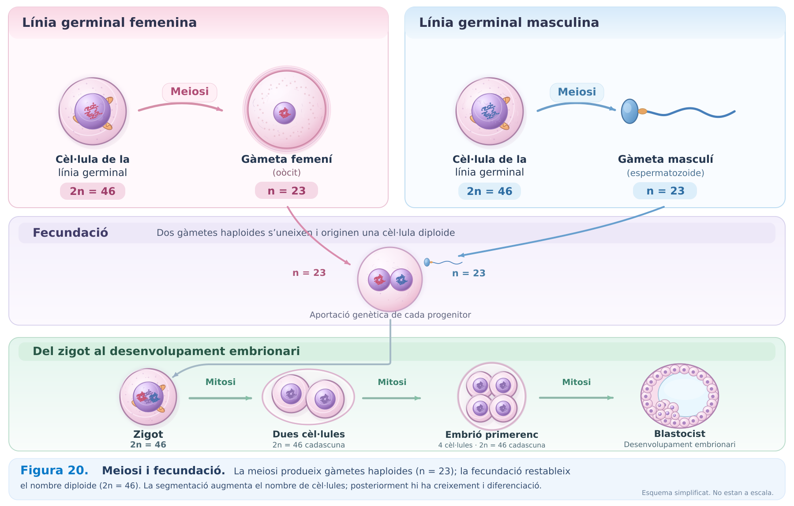

*Figura F20. Meiosi i fecundació.*

La meiosi no produeix directament gàmetes en tots els organismes. !!! warning "La meiosi no sempre forma gàmetes directament"

    En les plantes, per exemple, origina espores haploides que poden desenvolupar-se mitjançant mitosis abans de la formació dels gàmetes.

Per tant, la seva funció general és **reduir el nombre de cromosomes i contribuir a la reproducció sexual**, encara que el seu paper concret varia segons el cicle biològic de cada organisme.

### 4.2 · Què és la meiosi?

La **meiosi** és un procés de divisió nuclear característic dels organismes eucariotes amb reproducció sexual, en el qual una cèl·lula diploide experimenta habitualment dues divisions nuclears successives després d'una única duplicació de l'ADN.

Aquest procés permet obtenir quatre nuclis haploides a partir d'un nucli diploide inicial.

Les dues divisions reben el nom de:

- **Meiosi I:** primera divisió, en què se separen els cromosomes homòlegs i es redueix el nombre de cromosomes.
- **Meiosi II:** segona divisió, en què se separen les cromàtides germanes, de manera semblant al que succeeix durant la mitosi.

Abans de començar la meiosi, l'ADN es duplica durant la fase S de la interfase. Després d'aquesta duplicació, cada cromosoma està format per dues cromàtides germanes.

Entre la meiosi I i la meiosi II **no es produeix una nova replicació de l'ADN**.

<!-- FIGURA F21 · Una duplicació i dues divisions.
Cèl·lula inicial 2n = 4 → duplicació → meiosi I: dues cèl·lules n = 2 amb cromosomes duplicats → meiosi II: quatre cèl·lules n = 2 amb cromosomes no duplicats. Dues parelles d'homòlegs distingibles per longitud i color. Sense replicació entre les divisions. Derivar de M01. -->

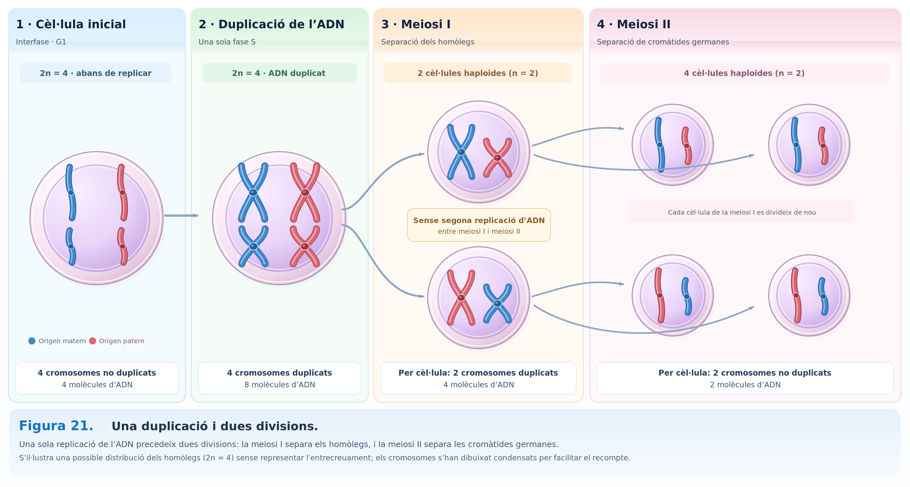

*Figura F21. Una duplicació i dues divisions.*

La meiosi no consisteix simplement a dividir una cèl·lula dues vegades. La clau del procés és **què se separa en cadascuna de les divisions**.

### 4.3 · La meiosi I: separació dels cromosomes homòlegs

!!! info "Meiosi I: divisió reduccional"

    La primera divisió meiòtica és una divisió *reduccional*, perquè transforma un conjunt diploide de cromosomes en dos conjunts haploides.

Durant aquesta divisió, els cromosomes homòlegs s'aparellen i posteriorment se separen.

#### Profase I

La profase I és una fase especialment important i més complexa que la profase de la mitosi.

Els cromosomes es condensen i els cromosomes homòlegs s'aparellen mitjançant un procés anomenat **sinapsi**.

Com que cada cromosoma ja s'ha duplicat, cada parella d'homòlegs està formada per quatre cromàtides. Aquest conjunt rep el nom de **bivalent** o *tètrada*.

Durant la profase I pot produir-se un intercanvi de fragments d'ADN entre cromàtides no germanes dels cromosomes homòlegs. Aquest fenomen s'anomena **entrecreuament** o *crossing-over*.

L'entrecreuament origina cromàtides amb noves combinacions de variants genètiques i constitueix un mecanisme important de variabilitat genètica.

Els punts on es mantenen associats els cromosomes homòlegs després d'aquests intercanvis s'anomenen **quiasmes**.

Cap al final de la profase I es desorganitza l'embolcall nuclear i s'estableixen les connexions amb el fus meiòtic.

<!-- FIGURA F22 · Aparellament i entrecreuament.
Tres moments: homòlegs duplicats, bivalent i intercanvi de segments entre cromàtides no germanes. Un homòleg blau i un vermell; fragments intercanviats mantenen color d'origen. Els fragments han de ser equivalents; no mostrar pèrdua arbitrària d'ADN. Coherent amb F15 i M01. -->

*Figura F22. Aparellament i entrecreuament.*

#### Metafase I

Durant la metafase I, els bivalents es disposen a la regió equatorial de la cèl·lula.

A diferència de la metafase mitòtica, en què s'alineen cromosomes individuals, aquí s'organitzen **parelles de cromosomes homòlegs**.

L'orientació de cada parella respecte dels pols és independent de la de les altres parelles. Aquesta disposició contribuirà a generar diferents combinacions de cromosomes en les cèl·lules resultants.

#### Anafase I

Durant l'anafase I, els cromosomes homòlegs se separen i es desplacen cap a pols oposats.

**Les cromàtides germanes romanen unides.**

Aquesta és la diferència fonamental respecte de l'anafase mitòtica.

Com que cada pol rep només un cromosoma de cada parella d'homòlegs, el nombre de cromosomes es redueix a la meitat.

#### Telofase I i citocinesi

Els cromosomes arriben als pols i habitualment es produeix la divisió del citoplasma.

El resultat són dues cèl·lules amb un conjunt haploide de cromosomes, encara que cadascun continua format per dues cromàtides.

La reorganització de l'embolcall nuclear i el grau de descondensació dels cromosomes poden variar segons l'organisme.

<!-- FIGURA F23 · Les fases de la meiosi I.
Profase I, metafase I, anafase I, telofase I; model 2n = 4. Dos bivalents a metafase I. Separar homòlegs complets amb cromàtides encara unides a anafase I. Conservar recombinació de F22. Resultat: dues cèl·lules n = 2 amb cromosomes duplicats. Derivar de M01. -->

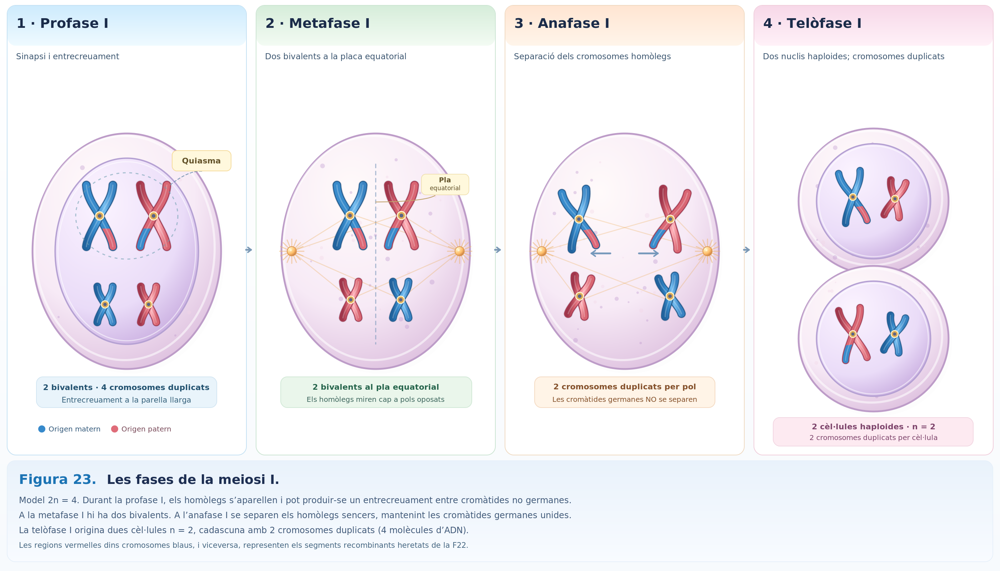

*Figura F23. Les fases de la meiosi I.*

### 4.4 · La meiosi II: separació de les cromàtides germanes

Després de la meiosi I comença la segona divisió meiòtica.

Les cèl·lules que entren en meiosi II són haploides, però els seus cromosomes continuen duplicats.

!!! info "Meiosi II: divisió equacional"

    La meiosi II és una divisió *equacional*, perquè el nombre de cromosomes de cada nucli descendent es manté respecte del nucli que inicia aquesta segona divisió.

#### Profase II

Els cromosomes es condensen, si s'havien descondensat, i es forma un nou fus meiòtic.

Si s'havia reorganitzat l'embolcall nuclear, aquest torna a desorganitzar-se.

#### Metafase II

Els cromosomes duplicats s'alineen individualment a la regió equatorial.

Els cinetocors de les cromàtides germanes s'orienten cap a pols oposats.

#### Anafase II

Les cromàtides germanes se separen i es desplacen cap als pols oposats.

A partir d'aquest moment, cadascuna es considera un cromosoma independent.

#### Telofase II i citocinesi

Es formen els nuclis descendents i habitualment es completa la divisió del citoplasma.

El resultat general són **quatre cèl·lules haploides**, amb cromosomes no duplicats.

Aquestes cèl·lules no solen ser genèticament idèntiques entre si, a causa dels mecanismes de recombinació i distribució dels cromosomes que han actuat durant la meiosi.

<!-- FIGURA F24 · Les fases de la meiosi II.
Continuació de F23: dues cèl·lules n = 2 amb cromosomes duplicats. Profase II, metafase II, anafase II i telofase II. Separar cromàtides germanes a anafase II. Quatre cèl·lules finals n = 2 amb cromosomes no duplicats. Conservar colors i fragments recombinats. Derivar de M01. -->

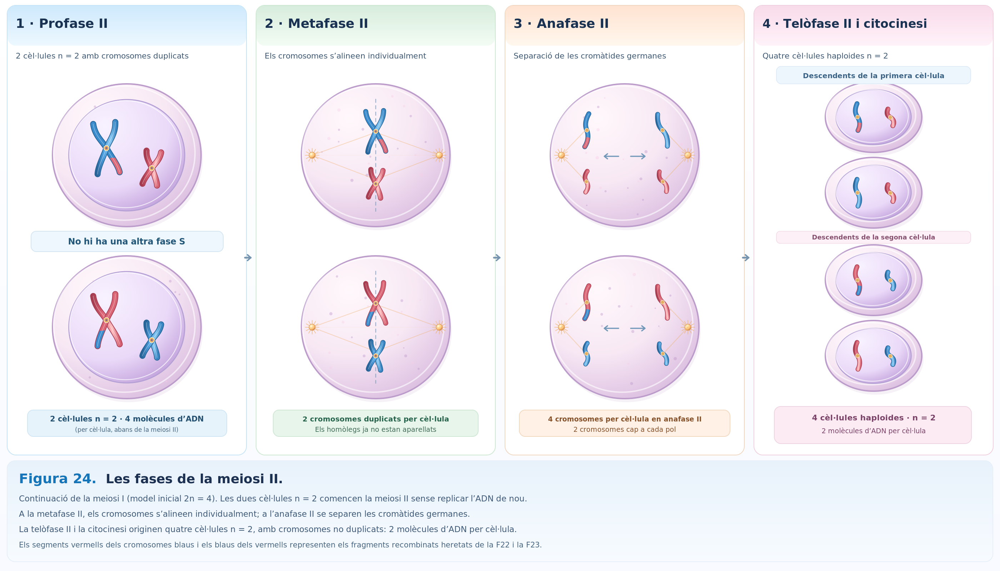

*Figura F24. Les fases de la meiosi II.*

### 4.5 · Seguim els cromosomes durant la meiosi

Per comprendre correctament la meiosi, convé seguir el nombre de cromosomes i de molècules d'ADN al llarg del procés.

Considerem una cèl·lula diploide amb quatre cromosomes:

$$2n=4$$

Aquesta cèl·lula té dues parelles de cromosomes homòlegs.

Abans de la meiosi, els quatre cromosomes es dupliquen. Després de la duplicació, continua havent-hi quatre cromosomes, però cadascun està format per dues cromàtides.

Durant la meiosi I se separen els cromosomes homòlegs. Cada cèl·lula resultant té dos cromosomes duplicats.

Durant la meiosi II se separen les cromàtides germanes. Finalment, cadascuna de les quatre cèl·lules resultants té dos cromosomes no duplicats.

| Moment | Cromosomes per cèl·lula | Molècules d'ADN nuclear per cèl·lula | Dotació |
|---|---:|---:|---|
| Abans de duplicar l'ADN | 4 | 4 | 2n |
| Després de duplicar l'ADN | 4 | 8 | 2n |
| Metafase I | 4 | 8 | 2n |
| Després de la meiosi I | 2 | 4 | n |
| Metafase II | 2 | 4 | n |
| Després de la meiosi II | 2 | 2 | n |

Els recomptes corresponen a les etapes indicades, no als instants transitoris de l'anafase. La dotació n o 2n indica el nombre de conjunts cromosòmics, no si l'ADN està duplicat.

<!-- FIGURA F25 · Seguiment cromosòmic de la meiosi.
Diagrama complet 2n = 4: cromosomes inicials, duplicació, separació d'homòlegs a meiosi I i separació de cromàtides a meiosi II. Recompte de cromosomes i molècules d'ADN per cèl·lula. Mateixos colors i convencions que F19. Derivar de M01. -->

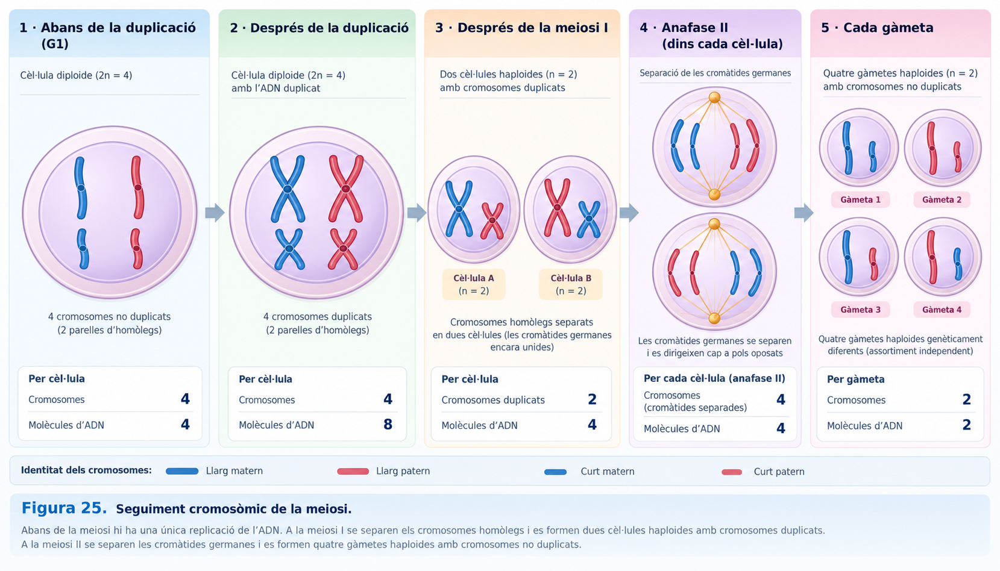

*Figura F25. Seguiment cromosòmic de la meiosi.*

La reducció cromosòmica es produeix durant la primera divisió meiòtica. La segona divisió no torna a reduir el nombre de cromosomes a la meitat.

### 4.6 · Per què la meiosi genera variabilitat genètica?

!!! tip "La meiosi té dues conseqüències"

    La meiosi no només redueix el nombre de cromosomes. També contribueix a generar noves combinacions de la informació genètica.

Dos mecanismes són especialment importants.

#### L'entrecreuament

Durant la profase I, l'intercanvi de fragments entre cromàtides no germanes dels cromosomes homòlegs pot produir noves combinacions d'al·lels en un mateix cromosoma.

Aquest procés s'anomena **recombinació genètica**.

Per exemple, si dos cromosomes homòlegs presenten combinacions diferents d'al·lels, l'entrecreuament pot originar cromàtides que combinin fragments procedents dels dos cromosomes originals.

#### La distribució independent dels cromosomes homòlegs

Durant la metafase I, cada parella de cromosomes homòlegs pot orientar-se de dues maneres respecte dels pols del fus.

Com que l'orientació de cada parella és independent de les altres, es poden formar diferents combinacions de cromosomes.

En un organisme amb dues parelles de cromosomes, hi ha:

$$2^2=4$$

combinacions possibles de cromosomes d'origen matern i patern, sense considerar l'entrecreuament.

En els humans, amb 23 parelles:

$$2^{23}=8.388.608$$

Això significa que la distribució independent pot originar més de vuit milions de combinacions cromosòmiques diferents en els gàmetes, fins i tot sense tenir en compte la recombinació.

Aquest nombre representa combinacions teòriques possibles, no el nombre de gàmetes diferents que necessàriament produeix un individu.

<!-- FIGURA F26 · Distribució independent dels homòlegs.
Dues orientacions alternatives de dos bivalents a metafase I, 2n = 4. Mostrar combinacions cromosòmiques resultants. Dos cromosomes llargs i dos de curts, colors d'origen matern/patern. Per aïllar el mecanisme, sense recombinació en aquesta figura. Derivar de M01. -->

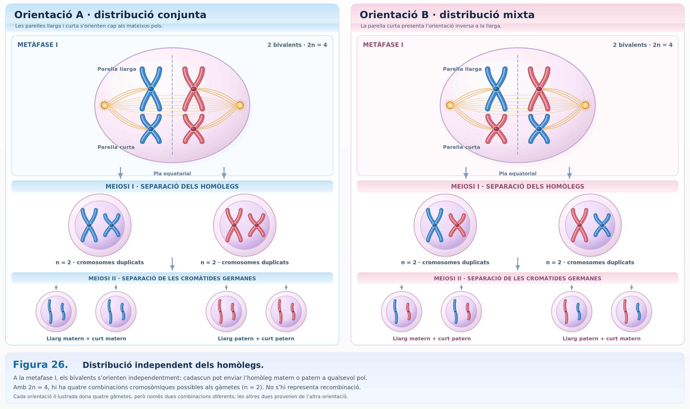

*Figura F26. Distribució independent dels homòlegs.*

La fecundació també contribueix a la variabilitat genètica, perquè combina aleatòriament la informació genètica de dos gàmetes.

Per tant, la reproducció sexual origina descendents amb combinacions genètiques que habitualment són diferents de les dels seus progenitors i dels seus germans.

### 4.7 · Mitosi i meiosi: dos processos amb funcions diferents

La mitosi i la meiosi comparteixen alguns mecanismes, com la formació del fus i el moviment dels cromosomes, però tenen conseqüències biològiques diferents.

| Característica | Mitosi | Meiosi |
|---|---|---|
| Duplicació de l'ADN | Una, abans de la divisió | Una, abans de la primera divisió |
| Divisions nuclears | Una | Dues |
| Aparellament d'homòlegs | No és característic | Sí, durant la profase I |
| Entrecreuament entre homòlegs | No és característic | Sí, durant la profase I |
| Què se separa? | Cromàtides germanes | Homòlegs a la meiosi I; cromàtides a la meiosi II |
| Nuclis resultants habituals | Dos | Quatre |
| Dotació cromosòmica | Es conserva | Es redueix a la meitat |
| Informació genètica | Generalment molt semblant | Habitualment diferent |
| Funció principal | Creixement, renovació i reproducció asexual | Reducció cromosòmica i contribució a la variabilitat genètica |

La diferència essencial és que **la mitosi conserva la dotació cromosòmica, mentre que la meiosi la redueix i reorganitza la informació genètica**.

<!-- FIGURA F27 · Mitosi i meiosi, comparació final.
Dues seqüències paral·leles des de cèl·lules diploides equivalents 2n = 4. Mitosi → dues cèl·lules 2n = 4; meiosi → quatre cèl·lules n = 2. Indicar separació d'homòlegs i de cromàtides. Mateixes convencions que F19/F25. No suggerir que una mateixa cèl·lula fa successivament mitosi i meiosi. Derivar de M01. -->

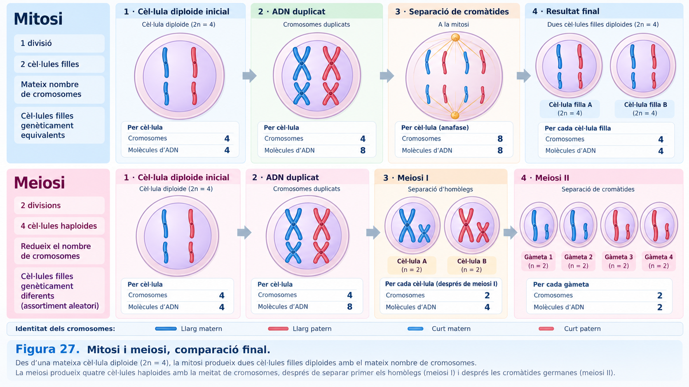

*Figura F27. Mitosi i meiosi, comparació final.*

#### Síntesi del bloc 4

La meiosi parteix d'una cèl·lula diploide que ha duplicat l'ADN. Durant la **meiosi I** s'aparellen i se separen els cromosomes homòlegs, de manera que es redueix la dotació de 2n a n. Durant la **meiosi II** se separen les cromàtides germanes. El resultat habitual són quatre cèl·lules haploides. L'entrecreuament i la distribució independent dels homòlegs contribueixen a la variabilitat genètica.

<!-- DOCENT · BLOC 4
Previsió orientativa: 2 sessions, exigents. Prioritzar què se separa en cadascuna de les divisions. Recuperar F14/F15 abans de començar. Seguir sempre model 2n = 4 abans de passar a 2n = 46. Diferenciar entrecreuament i distribució independent. F22 requereix màxima precisió científica. Figures F21, F23, F24 i F25 poden ser variants d'un mateix SVG. La UD3 reprendrà al·lels, recombinació i herència. -->

---

<!--
ESPECIFICACIÓ MESTRA DE FIGURA · NO MOSTRAR A L'ALUMNAT

FIGURA M01 · Model cromosòmic comú de mitosi i meiosi
Estat: pendent de generar. Prioritat: molt alta. Format: SVG editable.

OBJECTIU
Construir un model visual coherent que permeti seguir identitat, duplicació, recombinació i distribució dels mateixos cromosomes durant mitosi i meiosi; distingir homòlegs i cromàtides germanes i interpretar nombre de cromosomes i quantitat d'ADN.

MODEL DE REFERÈNCIA
Cèl·lula diploide hipotètica 2n = 4, amb dues parelles d'homòlegs:
- Parella 1: dos cromosomes llargs, matern blau i patern vermell.
- Parella 2: dos cromosomes curts, matern blau i patern vermell.
- Els homòlegs tenen igual longitud i posició relativa del centròmer.
- Cada cromosoma es pot representar no duplicat (una cromàtide) o duplicat (dues cromàtides germanes).
- En recombinació, els segments intercanviats conserven el color de l'origen de l'ADN; les cromàtides resultants poden contenir els dos colors.

SEQÜÈNCIES DERIVADES
A. Mitosi: una replicació prèvia, una divisió, separació de cromàtides germanes, dos nuclis 2n = 4.
B. Meiosi: una replicació prèvia, dues divisions, aparellament i recombinació, separació d'homòlegs a meiosi I i de cromàtides a meiosi II; quatre nuclis n = 2.
C. Comparació: seqüències paral·leles que parteixen de configuracions cromosòmiques equivalents; indicar què se separa a cada divisió.

REQUISITS TÈCNICS
SVG editable amb identificadors independents per cromosoma, cromàtide, centròmer i segment recombinat. Mantenir dimensions, colors, identitat i posicions relatives coherents entre fases. Separar cromosomes, fus, embolcalls i etiquetes per permetre ressaltat interactiu. Dissenyar base compartida per figures F15, F17, F19, F21, F22, F23, F24, F25, F26 i F27; també F13 si escau.

PRECAUCIONS
Replicar l'ADN no duplica el nombre de cromosomes. Els homòlegs se separen a meiosi I; les cromàtides germanes, a mitosi i meiosi II. Quan se separen, cada cromàtide passa a ser un cromosoma independent. La recombinació no representa pèrdua ni intercanvi arbitrari de material genètic. El color identifica origen de fragments d'ADN, no simplement pertinença d'un cromosoma a una cèl·lula.
-->